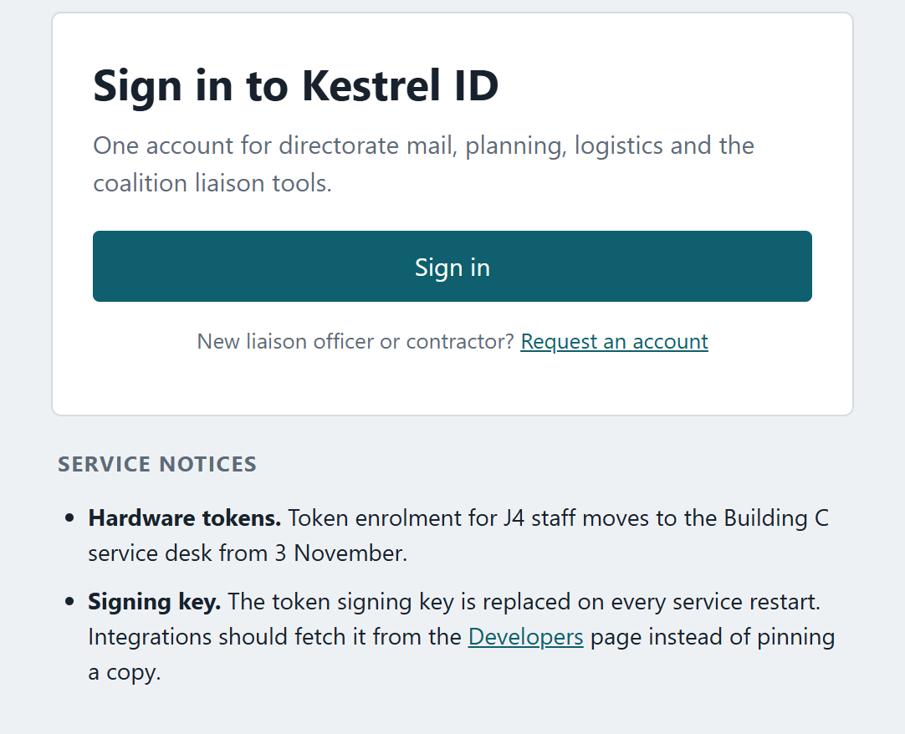
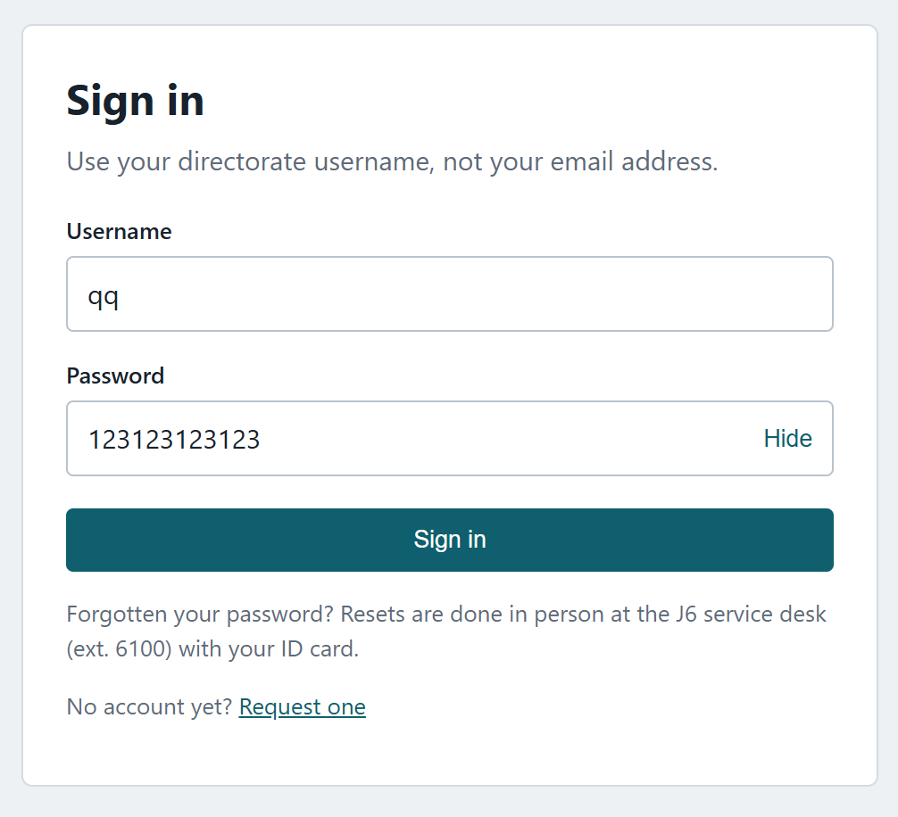
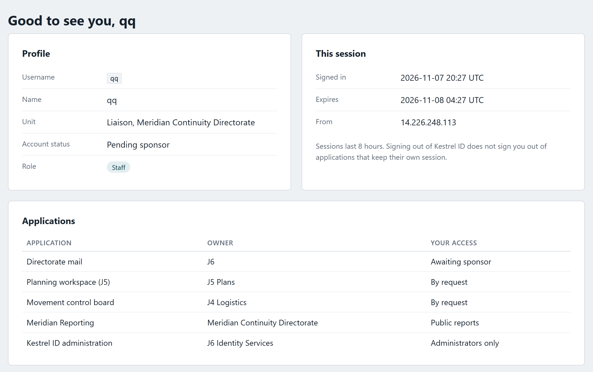
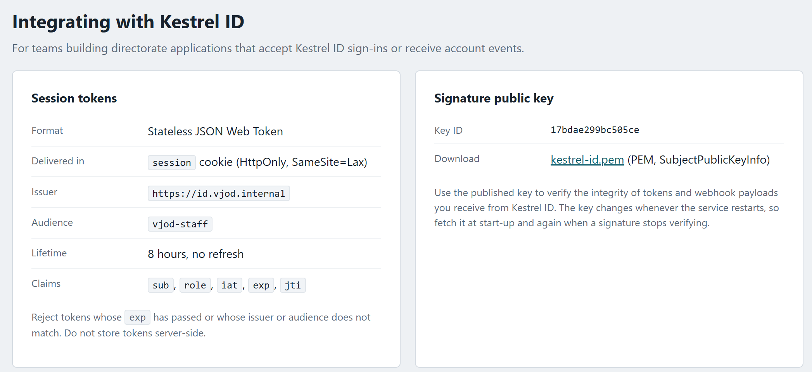
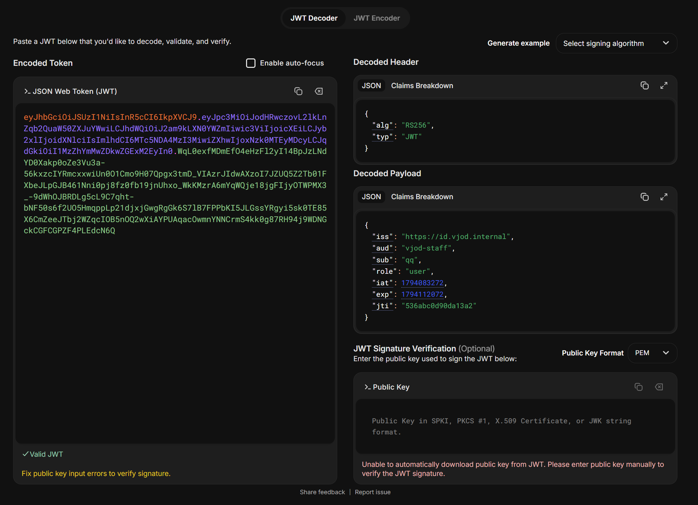
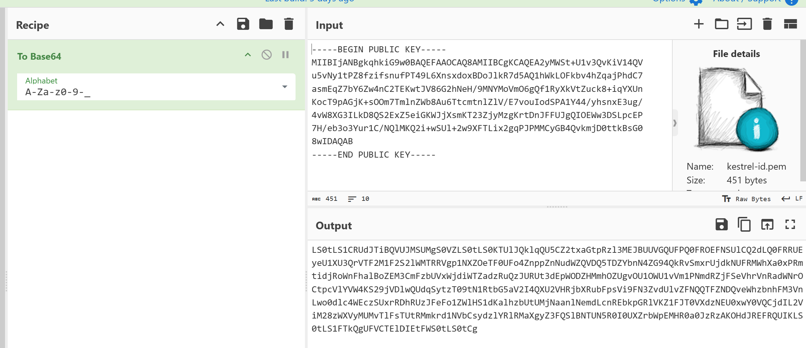
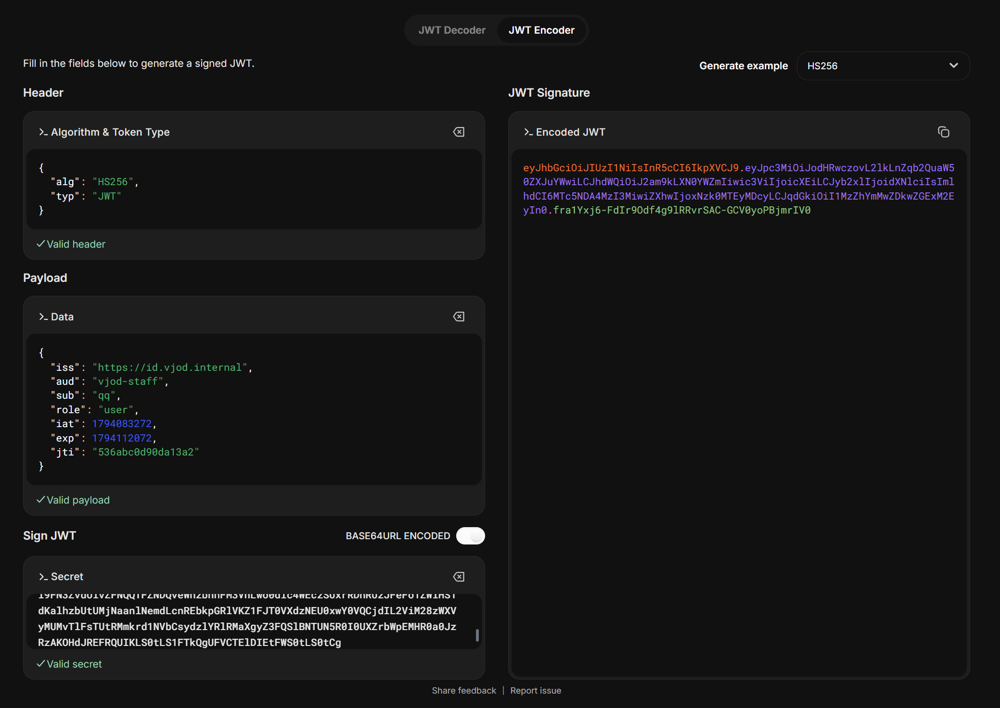
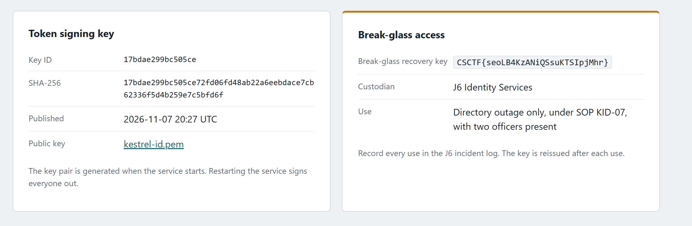

---
{
  title: keyring,
  date: 2026-11-08,
  ctf: CSCTF 2026,
  category: web,
  difficulty: Gold 4,
  tags: [ Auth Bypass, Broken Access Control, JWT, Key Confusion, HS256 ]
}
---

# Đề bài 
Kestrel ID is the staff sign-on for the Vardanne Joint Operations Directorate, which coordinates Vardanne's part in the Operation Dawn coalition. Liaison officers can request an account and sign in straight away, but the administration console is limited to directorate administrators, and it holds the break-glass recovery key.

Recover that key. Start your own instance from this page and work only against the address it gives you.

Flag format: CSCTF{...}
# Solution
Truy cập challenge

Ta đăng kí account rồi đăng nhập vào 

Ở `/developers` có chỉ rõ cụ thể các thông tin về cookie session của trang web này và cho phép tải PEM 

Trước hết đọc session bằng [jwt.io](https://www.jwt.io/)

Thấy `role` đang là `user`. Vậy cần đổi `role` thành `admin` sau đó truy cập route `/admin` để lấy flag

Thuật toán đang sử dụng ở đây là `RS256` (RSA Signature with SHA-256) là thuật toán bất đối xứng chỉ người nắm giữ `private key` mới có thể tạo `token`, trong khi bất kỳ ai cũng có thể dùng `public key` để xác thực
Ta thử đổi thuật toán thành `HS256` (viết tắt của HMAC-SHA256) là thuật toán ký xác thực đối xứng, sử dụng cùng một khóa bí mật (secret key) để vừa tạo chữ ký (sign) vừa xác minh chữ ký (verify).

Vì cho tải `public key` về nên có thể sử dụng `secret key` là `public key` được tải về

Từ đó dùng session này để truy cập `/admin`

-> Flag:
`CSCTF{seoLB4KzANiQSsuKTSIpjMhr}`

:::warning
Bài này giải được là bởi vì ứng dụng dùng nhầm cùng chuỗi byte PEM theo hai cách khác nhau:
- Với `RS256`, nó đọc PEM như khóa công khai RSA để kiểm tra chữ ký do khóa riêng tạo ra.
- Với `HS256`, nó coi các byte PEM đó là secret `HMAC`. `HMAC` chấp nhận bất kỳ chuỗi byte nào làm secret, nên ai tải được PEM cũng có thể tự tạo chữ ký `HS256`.
Lỗi nằm ở chỗ ứng dụng tin trường `alg` do token gửi lên và cho phép `HS256`. Header JWT không được phép tự quyết định thuật toán xác minh
:::
