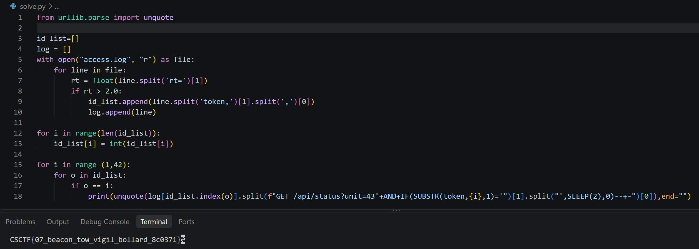

---
{
  title: "Operation Dawn: The Access Log",
  date: 2026-11-09,
  ctf: CSCTF 2026,
  category: web,
  difficulty: Bronze 2,
  tags: [ SQL Injection, Time-based Blind, Log Analysis, MySQL, SLEEP, Python ]
}
---

# Đề bài 
Operation Dawn, annex entry 07. The Ash Army ran a status portal for its canal checkpoint, and coalition cyber teams seized the web server's log. One visitor walked out of the portal's database with the checkpoint's link secret and never drew an error page. Recover what they took and submit it exactly as recovered. It already carries its own braces, so do not wrap it again.


The portal, its units and every host in the log are fictional. Attachment: `access.log`, 514,137 bytes, SHA-256 `3bb180802cc90b56984f179cb4315fc805d1e047e8a2374544044858fea30db2`. Each line is nginx's combined format followed by `rt=`, the request time in seconds.


Flag format: `CSCTF{...}`
File: [access.log](https://github.com/Drakie14/Challenges/blob/main/CSCTF2026/access.log)
# Solution
Truy cập file thì ta thấy 1 loạt các log có format tương tự nhau thuộc dạng `Time-based Oracle SQL injection`
```txt
198.51.100.66 - - [13/Oct/2026:03:00:31 +0000] "GET /api/status?unit=43'+AND+IF(SUBSTR(token,6,1)='Z',SLEEP(2),0)--+- HTTP/1.1" 200 33 "-" "python-requests/2.32.3" rt=0.057
```
-> Payload có dạng:
```sql 
43'+AND+IF(SUBSTR(token,<id>,1)='<ký_tự_dự_đoán>',SLEEP(2),0)--+-
```
Phân tích từng thành phần:
| Thành phần | Chức năng |
|---|---|
| `43'` | Đóng dấu nháy đơn của chuỗi SQL ban đầu |
| `AND` | Nối thêm điều kiện vào mệnh đề `WHERE` |
| `IF(condition, true, false)` | Kiểm tra điều kiện và trả về một trong hai biểu thức |
| `SUBSTR(token,<id>,1)` | Lấy 1 ký tự của `token` tại vị trí `<id>` |
| `='<ký_tự_dự_đoán>'` | So sánh ký tự vừa lấy với ký tự dự đoán |
| `SLEEP(2)` | Làm MySQL chờ khoảng 2 giây |
| `0` | Giá trị trả về khi điều kiện sai |
| `-- -` | Comment phần SQL còn lại |

Mục đích của payload này là nếu như `<ký_tự_real>` tại vị trí `<id>` chính là `<ký_tự_dự_đoán>` thì sẽ làm MySQL chờ khoảng 2 giây. Từ đó đọc `rt`(viết tắt cho `roundtrip`) là thời gian phản hồi (response time) của ứng dụng, được đo từ lúc gửi yêu cầu HTTP đến lúc nhận được phản hồi từ máy chủ. Nếu `rt`>2.00s thì chứng tỏ đó là ký tự đúng tại vị trí đó

Vậy cần viết script python lấy về các `<ký_tự_dự_đoán>` ở các line có `rt`>2.00s:
```python
from urllib.parse import unquote

id_list=[]
log = []
with open("access.log", "r") as file:
    for line in file:
        rt = float(line.split('rt=')[1])
        if rt > 2.0:
            id_list.append(line.split('token,')[1].split(',')[0])
            log.append(line)

for i in range(len(id_list)):
    id_list[i] = int(id_list[i])

for i in range (1,42):
    for o in id_list:
        if o == i:
            print(unquote(log[id_list.index(o)].split(f"GET /api/status?unit=43'+AND+IF(SUBSTR(token,{i},1)='")[1].split("',SLEEP(2),0)--+-")[0]),end="")
```

-> Flag:
`CSCTF{07_beacon_tow_vigil_bollard_8c0371}`
