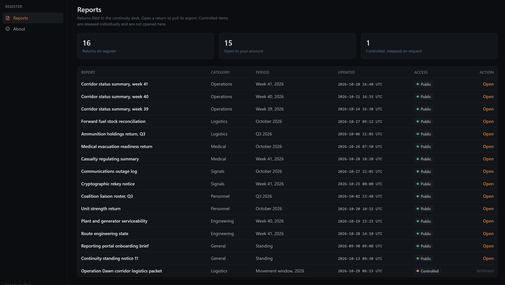
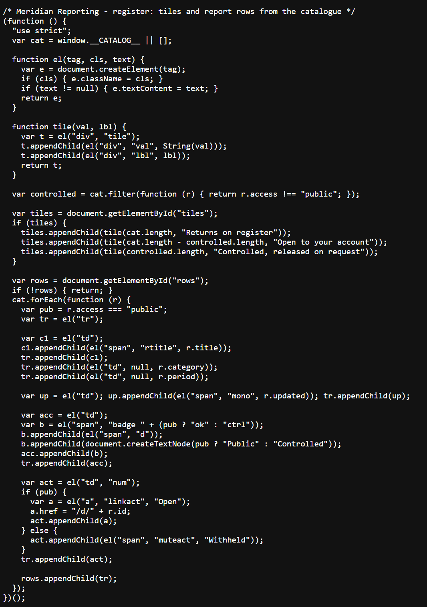
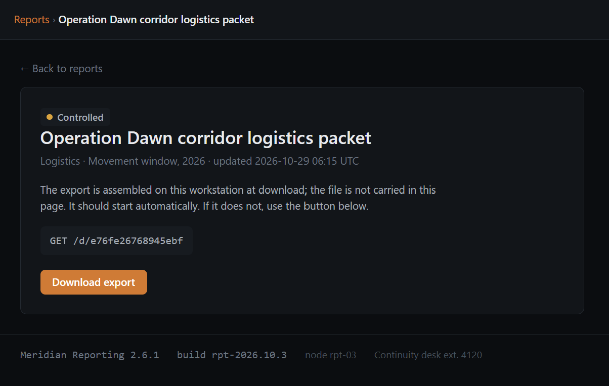

---
{
  title: smuggler,
  date: 2026-11-09,
  ctf: CSCTF 2026,
  category: web,
  difficulty: Bronze 4,
  tags:
    [
      Information Disclosure,
      Broken Access Control,
      IDOR,
      Source Code Review,
      Hidden Endpoint
    ]
}
---

# Đề bài 
Meridian Reporting is the internal reporting portal of the Meridian Continuity Directorate, a coalition partner in the Operation Dawn theatre. Desks file their returns here and most are listed for download, but one controlled packet is withheld from the dashboard and released only to a named distribution list.


Recover that packet. Start your own instance from this page and work only against the address it gives you.


Flag format: `CSCTF{...}`
# Solution
Truy cập challenge

Nhấn thử `Open` thì thấy được chuyển qua trang có dạng `/d/<id>` để tải `package` về

Đọc source code thấy có đoạn khả nghi
```html 
<script nonce="12FIOmdcAl8hpNGebSLjdQ">window.__CATALOG__ = [{"id": "corridor-status-wk41", "title": "Corridor status summary, week 41", "category": "Operations", "period": "Week 41, 2026", "updated": "2026-10-28 16:40 UTC", "access": "public"}, {"id": "corridor-status-wk40", "title": "Corridor status summary, week 40", "category": "Operations", "period": "Week 40, 2026", "updated": "2026-10-21 16:35 UTC", "access": "public"}, {"id": "corridor-status-wk39", "title": "Corridor status summary, week 39", "category": "Operations", "period": "Week 39, 2026", "updated": "2026-10-14 16:30 UTC", "access": "public"}, {"id": "fuel-stock-oct", "title": "Forward fuel stock reconciliation", "category": "Logistics", "period": "October 2026", "updated": "2026-10-27 09:12 UTC", "access": "public"}, {"id": "ammunition-return-q3", "title": "Ammunition holdings return, Q3", "category": "Logistics", "period": "Q3 2026", "updated": "2026-10-06 11:05 UTC", "access": "public"}, {"id": "medevac-readiness", "title": "Medical evacuation readiness return", "category": "Medical", "period": "October 2026", "updated": "2026-10-26 07:50 UTC", "access": "public"}, {"id": "casualty-regulating", "title": "Casualty regulating summary", "category": "Medical", "period": "Week 41, 2026", "updated": "2026-10-28 18:20 UTC", "access": "public"}, {"id": "comms-outage-log", "title": "Communications outage log", "category": "Signals", "period": "October 2026", "updated": "2026-10-27 22:05 UTC", "access": "public"}, {"id": "crypto-rekey-notice", "title": "Cryptographic rekey notice", "category": "Signals", "period": "Week 41, 2026", "updated": "2026-10-25 08:00 UTC", "access": "public"}, {"id": "liaison-roster-q3", "title": "Coalition liaison roster, Q3", "category": "Personnel", "period": "Q3 2026", "updated": "2026-10-02 13:40 UTC", "access": "public"}, {"id": "strength-return-oct", "title": "Unit strength return", "category": "Personnel", "period": "October 2026", "updated": "2026-10-20 10:15 UTC", "access": "public"}, {"id": "plant-serviceability", "title": "Plant and generator serviceability", "category": "Engineering", "period": "Week 40, 2026", "updated": "2026-10-19 15:25 UTC", "access": "public"}, {"id": "route-engineering", "title": "Route engineering state", "category": "Engineering", "period": "Week 41, 2026", "updated": "2026-10-28 14:10 UTC", "access": "public"}, {"id": "onboarding-brief", "title": "Reporting portal onboarding brief", "category": "General", "period": "Standing", "updated": "2026-09-30 09:00 UTC", "access": "public"}, {"id": "continuity-notice-11", "title": "Continuity standing notice 11", "category": "General", "period": "Standing", "updated": "2026-10-13 09:30 UTC", "access": "public"}, {"id": "e76fe26768945ebf", "title": "Operation Dawn corridor logistics packet", "category": "Logistics", "period": "Movement window, 2026", "updated": "2026-10-29 06:15 UTC", "access": "controlled"}];</script>
<script nonce="12FIOmdcAl8hpNGebSLjdQ" src="/static/js/dashboard.js?v=1359a45ec1"></script>
```
Truy cập `/static/js/dashboard.js?v=1359a45ec1`

Vậy để có thể `Open` thực chất chỉ là `a.href = "/d/" + r.id` với data lấy từ `window.__CATALOG__`

Vậy đọc đến cuối thì thấy 

```json
{"id": "e76fe26768945ebf", "title": "Operation Dawn corridor logistics packet", "category": "Logistics", "period": "Movement window, 2026", "updated": "2026-10-29 06:15 UTC", "access": "controlled"}
```
-> `id` của package bị control là `e76fe26768945ebf`
Truy cập `/d/e76fe26768945ebf` thì ta sẽ có được flag nằm trong gói package tải về

Flag nằm trong file `02-release-authorization.txt`:
```txt
Release authorization
=====================
This packet is released under single-use authorization. Quote the
authorization code below when you acknowledge receipt to the continuity desk.

  Authorization code: CSCTF{KGN6vovJHPXOF5bJYRiPY4Rv}

Handling: return or destroy the packet after the movement window closes.
```
-> Flag:
`CSCTF{KGN6vovJHPXOF5bJYRiPY4Rv}`
