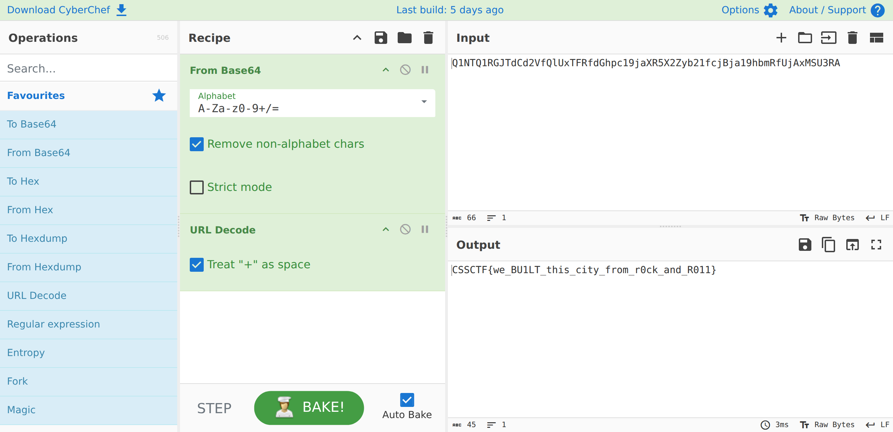

## Đề bài
Welcome to Star City. Home of stars galore. But is there more to be seen than meets the eye?

http://34.116.80.78:9981/

Flag Format: `CSSCTF{...}`
## Solution
Truy cập vào challenge, ta thấy một dòng chữ `Welcome to Star City` nhấp nháy với hiệu ứng glitch


Ta xem source HTML thì thấy trang chỉ có đúng một `element` nội dung và nạp thêm một file CSS, đoạn cần lưu ý:
```html!
<h1 data-text="Welcome to Star City">Welcome to Star City</h1>
<link rel="stylesheet" href="style.css">
```
Trang gần như trống trơn, JavaScript cũng không có. Vậy chỗ duy nhất còn lại để "giấu" chính là `style.css`. Ta kéo hết file CSS xuống cuối, và ngay sau `@keyframes` cuối cùng có một [CSS comment](https://developer.mozilla.org/en-US/docs/Web/CSS/Comments) lạc lõng:
```css!
@keyframes shimmer { to { background-position: -300% 0; } } /*Q1NTQ1RGJTdCd2VfQlUxTFRfdGhpc19jaXR5X2Zyb21fcjBja19hbmRfUjAxMSU3RA*/
```
Chuỗi trong comment chỉ gồm `[A-Za-z0-9]`, không có ký tự lạ, độ dài là bội số quen thuộc — đúng dáng của [Base64](https://developer.mozilla.org/en-US/docs/Glossary/Base64). Thử Base64-decode thì ra `CSSCTF%7Bwe_BU1LT_this_city_from_r0ck_and_R011%7D` — gần đúng rồi, nhưng còn `%7B` và `%7D`, đó là [URL-encode](https://developer.mozilla.org/en-US/docs/Glossary/Percent-encoding) của `{` và `}`. 

Dùng [CyberChef](https://gchq.github.io/CyberChef/) làm trọn vẹn ngay trên trình duyệt. Các bước:

-> Flag: `CSSCTF{we_BU1LT_this_city_from_r0ck_and_R011}`
:::info 
Cái tên `Star City` cộng với `we BU1LT this city from r0ck and R011` là một câu đùa nhại lại bài hát *"We Built This City"* của ban nhạc Starship — "we built this city on rock and roll".
:::
