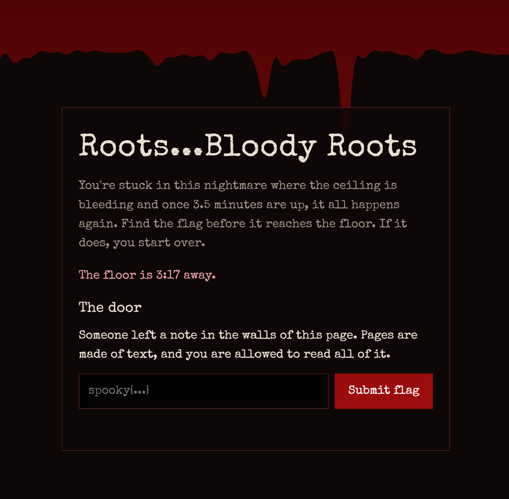
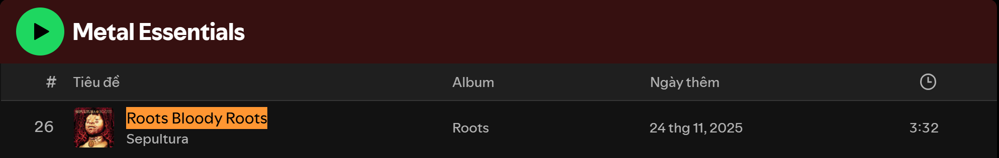

---
{
  title: Hemophobia,
  date: 2026-11-07,
  ctf: SpookyCTF 2026,
  category: web,
  difficulty: Sprout,
  tags: [ Web Enumeration, Source Code Review ]
}
---

# Đề bài 
You are trapped in this endless nightmare with music and blood seeping in through the ceiling, crawling down the walls. Once the blood reaches the bottom, your feet become rooted to the ground as the blood consumes you, and you relive it all over again. To escape you must find the key hidden within these walls, and only then can you escape this nightmare. Goodluck...

http://77.112.83.127
# Solution 
Truy cập challenge ta có giao diện

F12 để review source code, ta thấy có dòng comment khả nghi:
```html
<!-- There's a song that plays in this nightmare, but it's no longer here... I wrote it down somewhere though. I think it's in nightmare.txt...The flag looks like spooky{band} -->
```
-> Truy cập `/nightmare.txt` có được 
```txt
The song from the nightmare.
I wrote the title down so I wouldn't forget it:

  Roots Bloody Roots

I think this is where I heard it:

  https://open.spotify.com/playlist/37i9dQZF1DWWOaP4H0w5b0?si=Ygn6SH-USsy5zhZiDgaGaQ

Who made it?
```
Truy cập link spotify rồi kiếm bài nhạc `Roots Bloody Roots`

-> Flag:
`spooky{Sepultura}`
