---
{
  title: Scopophobia,
  date: 2026-11-07,
  ctf: SpookyCTF 2026,
  category: web,
  difficulty: Bronze 3,
  tags:
    [
      Information Disclosure,
      Web Enumeration,
      Source Code Review,
      Hidden Endpoint,
      HTML Comments
    ]
}
---

# Đề bài 
After months of unemployment, you finally land a big ol’ j-o-b in security. It’s minimum wage but hey, the experience is what matters. Though what they didn’t tell you was the physical security aspect. Analyze the dashboard and read the source to try to find what they don’t want you finding.

http://18.189.35.130/
# Solution
Truy cập challenge ta có giao diện 
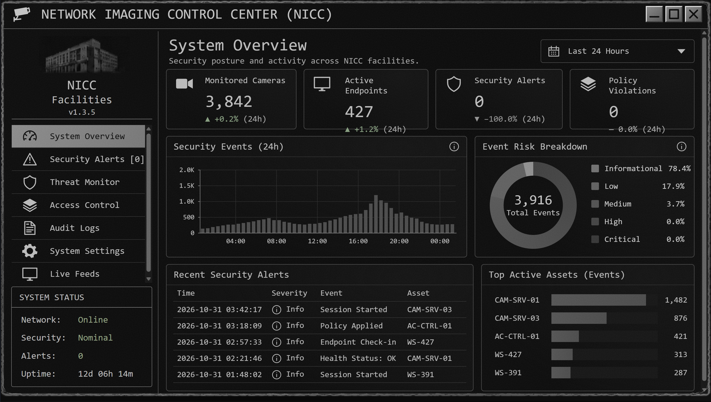
F12 để đọc source code thì thấy dòng hint mà tác giả để lại 
```html
<!-- NICC Imaging Migration Notes -->
<!-- TODO: Legacy camera inventory was excluded from the current monitoring migration. Confirm whether archival feeds were properly retired. -->
<!-- CAM-07 was scheduled for decommissioning but remains registered. -->
```
Check từng URL thì nhận thấy `/feeds/active/cam-01` liên quan nhất đến việc `Legacy camera` và `CAM-07`
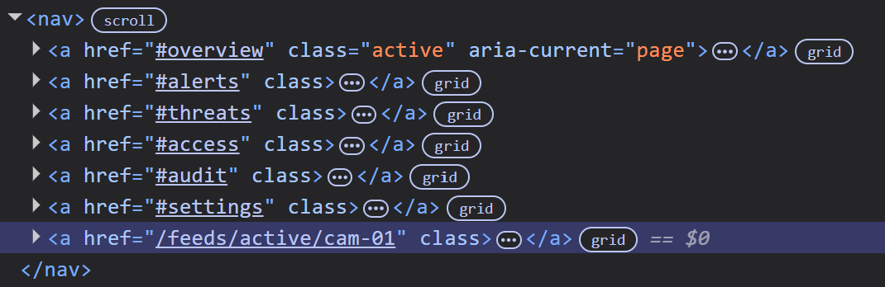
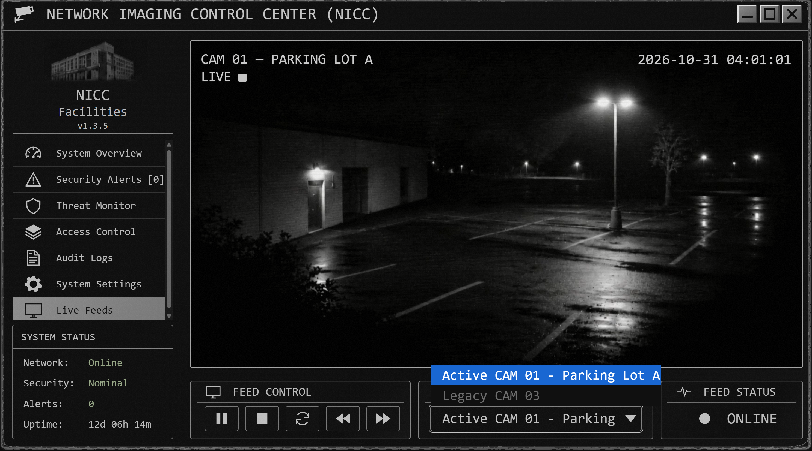
Vì có `Legacy CAM 03` nên có lẽ URL có dạng `feeds/legacy/cam-<id>`, ta thử truy cập `/feeds/legacy/cam-07`
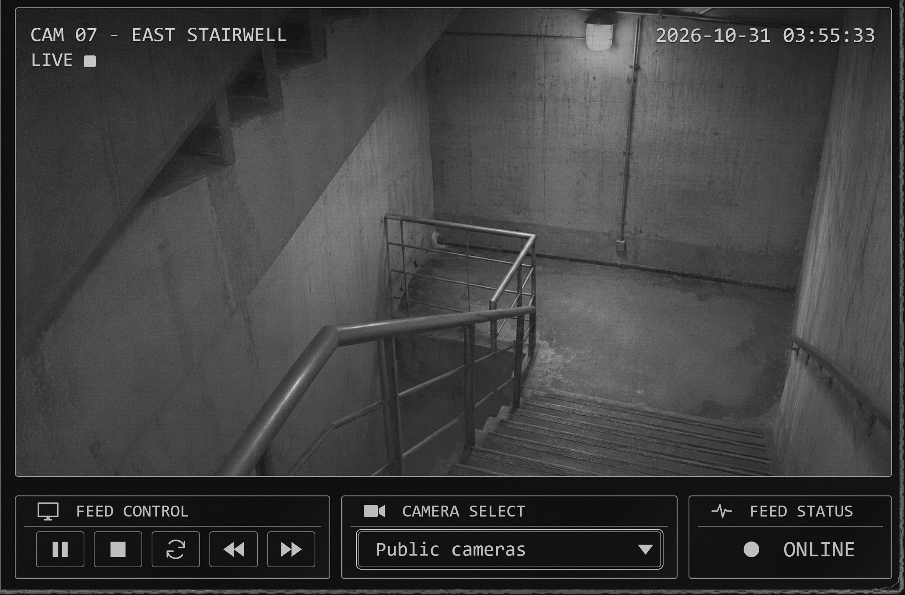
Đọc source thì thấy tác giả có để lại hint sau:
```html
<!-- Imaging migration record -->
<!-- Service camera directory: /feeds/service/ -->
```
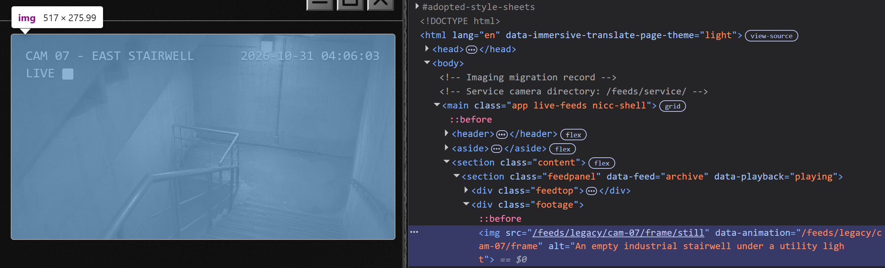
Ta thấy ở đây chỉ lấy `src` từ bức ảnh tĩnh và có animation nhưng không hiển thị. Ta truy cập 
`/feeds/legacy/cam-07/frame` để xem thẳng animation
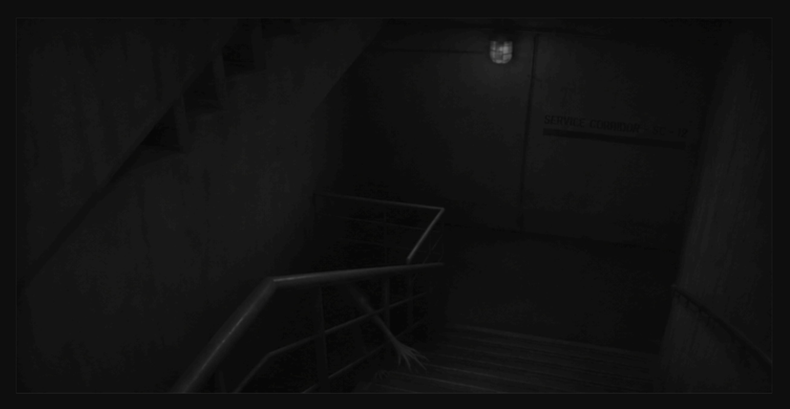
Ở trang này thì trên tường lại xuất hiện dòng chữ `SERVICE CORRIDOR-SC-12`. Ta truy cập thử `/feeds/service/sc-12`
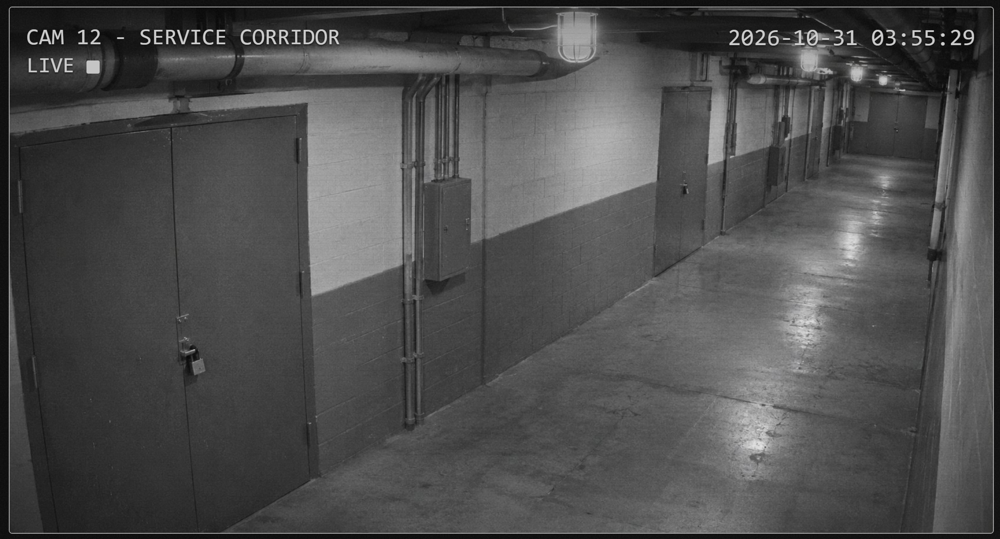
Tương tự, ta cũng có hint và animation ẩn đằng sau 
```html
<!-- Service feed migration incomplete -->
<!-- Redundant imaging namespace: /feeds/mirror/ -->
```
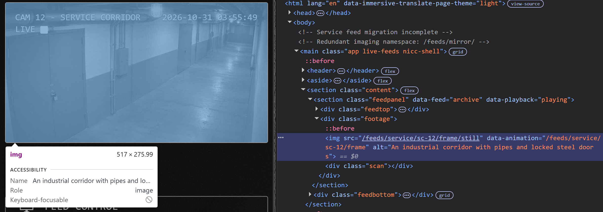
Truy cập `/feeds/service/sc-12/frame`
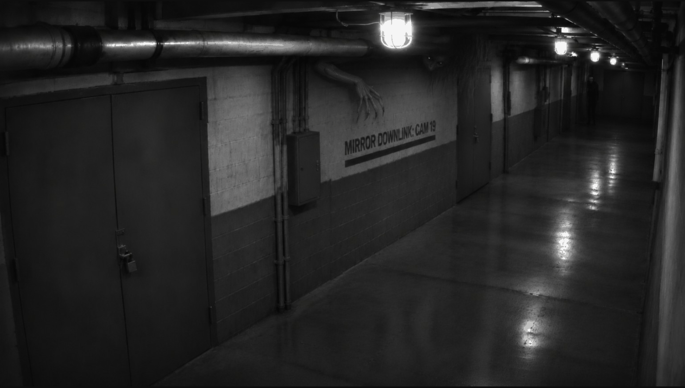
Ta truy cập thử `/feeds/mirror/cam-19`
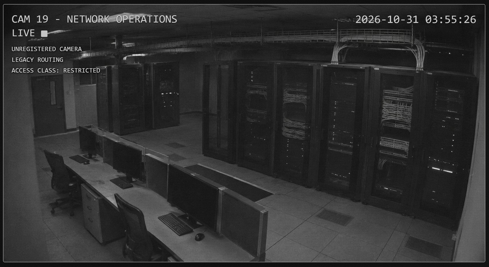
```html
<!-- Restricted camera migration -->
<!-- Sublevel imaging uses a three-letter directory alongside the other feeds. -->
```
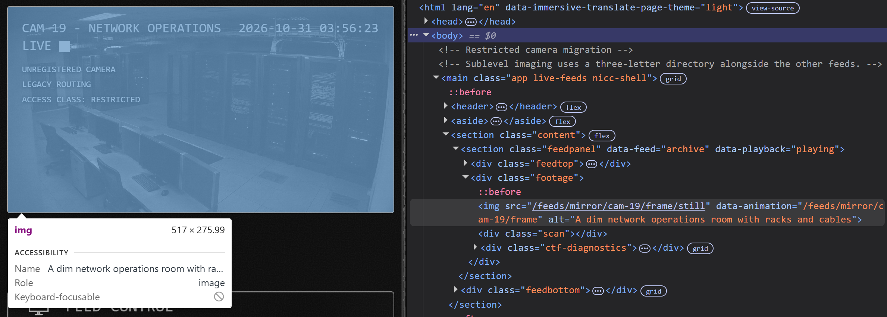
Truy cập `/feeds/mirror/cam-19/frame`
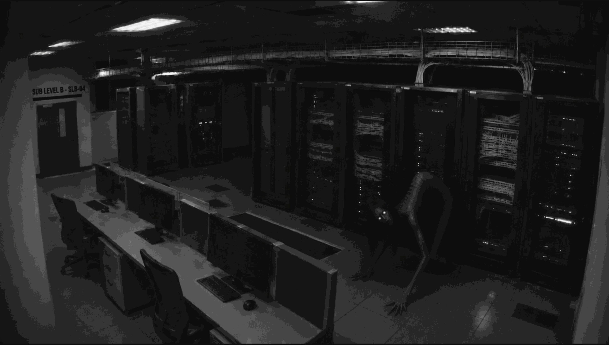
Ta truy cập thử `/feeds/sub/slb-04`
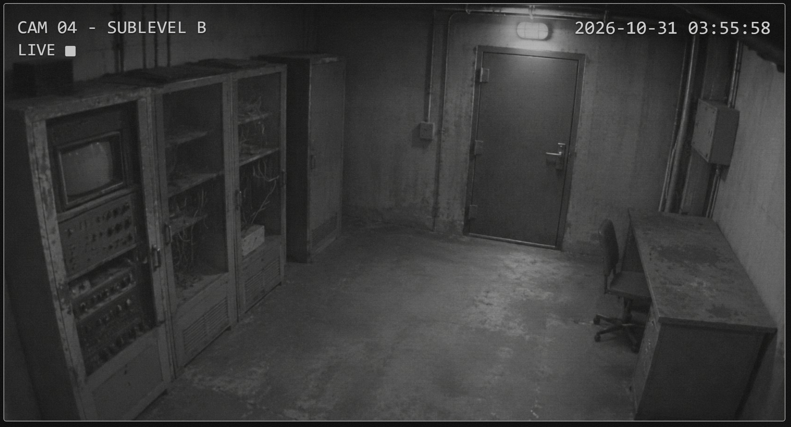
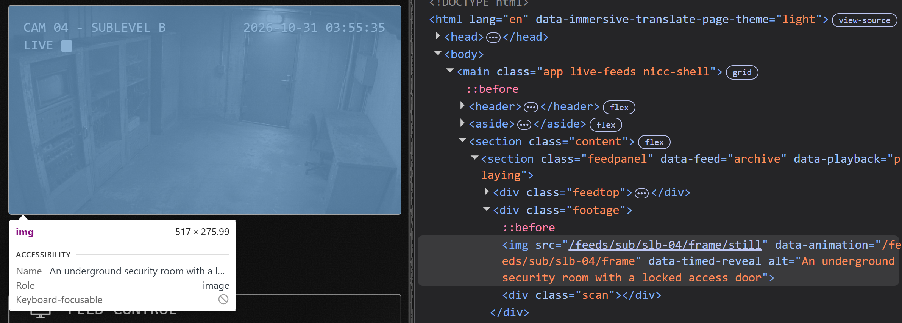
-> Truy cập `/feeds/sub/slb-04/frame`
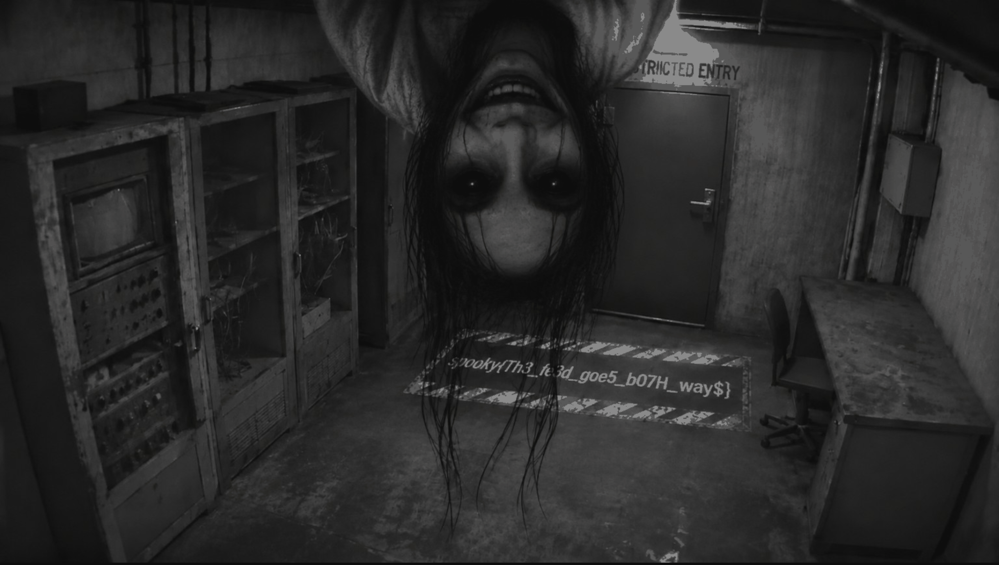
-> Flag:
`spooky{Th3_fe3d_goe5_b07H_ways}`
