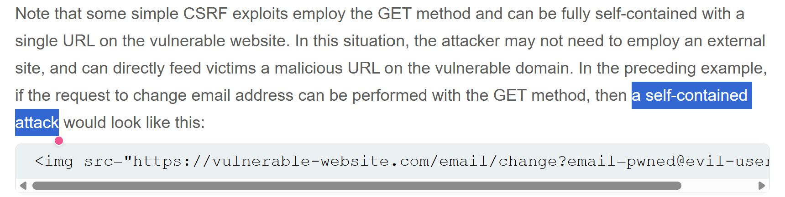
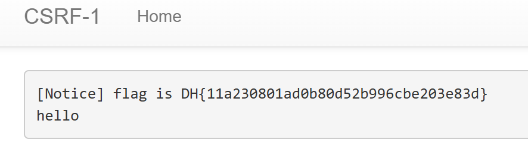

# Đề bài 
It is a service that implements several functions and a bot that checks the entered URL.

Use CSRF vulnerabilities to obtain flags.
https://dreamhack.io/wargame/challenges/26
# Solution
Trước tiên ta kiểm tra flag nằm ở đâu thấy nằm ở route `/admin/notice_flag` 
Vậy ta cần tìm cách truy cập vào route này và lấy về flag. Kiểm tra source code của route thấy ở route `/admin/notice_flag` có 2 lớp kiểm tra quyền:
1. Request được thực hiện từ host `127.0.0.1`
2. `userid` phải là `admin`

Nếu vượt qua được lớp validate này rồi thì flag sẽ được lưu lại tại route `/memo`
```python!
@app.route("/admin/notice_flag")
def admin_notice_flag():
    global memo_text
    if request.remote_addr != "127.0.0.1":
        return "Access Denied"
    if request.args.get("userid", "") != "admin":
        return "Access Denied 2"
    memo_text += f"[Notice] flag is {FLAG}\n"
    return "Ok"
```
```python
memo_text = ""


@app.route("/memo")
def memo():
    global memo_text
    text = request.args.get("memo", None)
    if text:
        memo_text += text
    return render_template("memo.html", memo=memo_text)
```
Mà ở route `/flag` đã giúp ta gửi request với `param` đến `http://127.0.0.1:8000/vuln?param=` 

Như tên của challenge này, ta sử dụng lỗ hổng [CSRF](https://portswigger.net/web-security/csrf#how-to-deliver-a-csrf-exploit) để  khai thác

Sử dụng element `img` để GET và lấy flag
-> Payload:
``

Sau đó vào `/memo` để lấy flag

-> Flag:
`DH{11a230801ad0b80d52b996cbe203e83d}`
