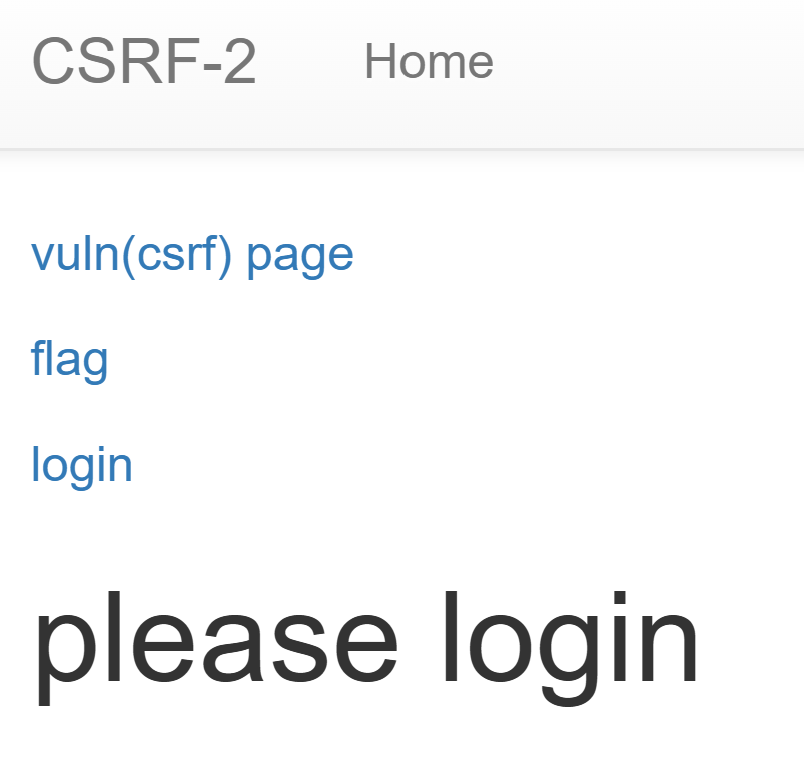
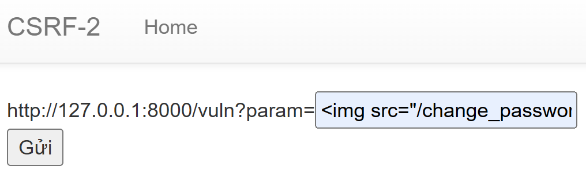
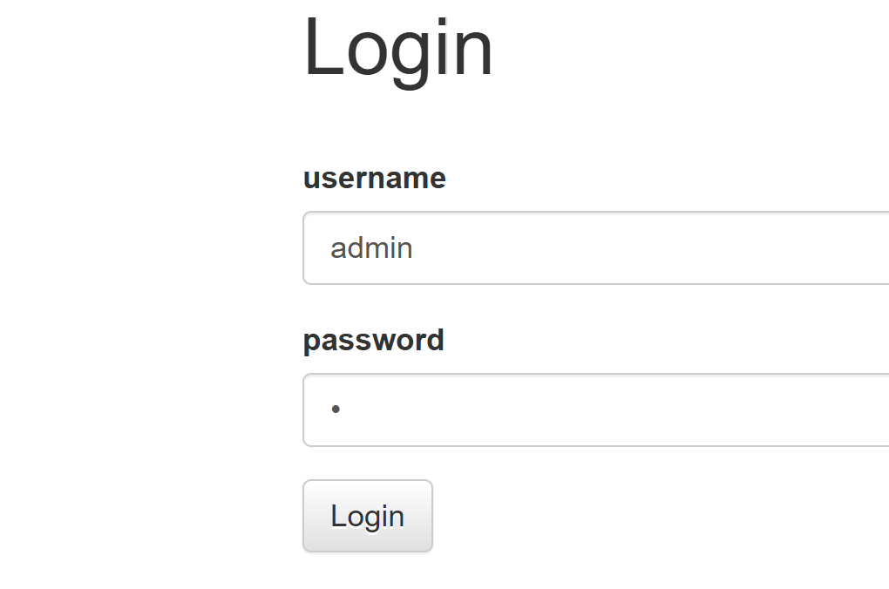
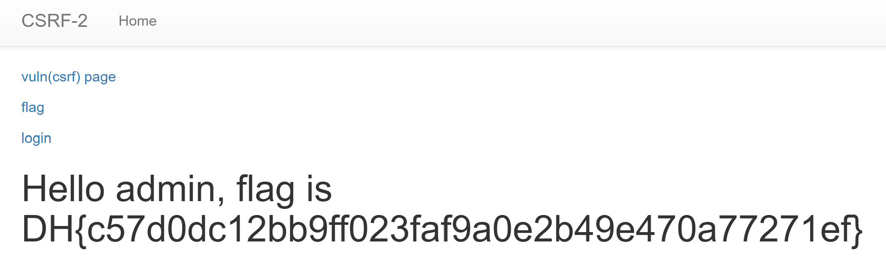

# Đề bài 
It is a service that implements several functions and a bot that checks the entered URL.

Use CSRF vulnerabilities to obtain flags.
https://dreamhack.io/wargame/challenges/269
# Solution
Truy cập challenge có giao diện như sau:

Đọc source thấy tại route `/` yêu cầu `sessionid` của admin để lấy flag
```python
@app.route("/")
def index():
    session_id = request.cookies.get('sessionid', None)
    try:
        username = session_storage[session_id]
    except KeyError:
        return render_template('index.html', text='please login')

    return render_template('index.html', text=f'Hello {username}, {"flag is " + FLAG if username == "admin" else "you are not an admin"}')
```
Vậy ta phải login vào acc `admin` để lấy được flag
```python
@app.route('/login', methods=['GET', 'POST'])
def login():
    ...
    elif request.method == 'POST':
        username = request.form.get('username')
        password = request.form.get('password')
        try:
            pw = users[username]    #Lấy password gốc tương ứng với username
        except:
            return '<script>alert("not found user");history.go(-1);</script>'
        if pw == password:   #Nếu password gốc giống với password mình nhập
            resp = make_response(redirect(url_for('index')) )
            session_id = os.urandom(8).hex()     #Tạo sessionid ngẫu nhiên cho user
            session_storage[session_id] = username   #Lưu vào storage
            resp.set_cookie('sessionid', session_id)   #Set cookie session
            return resp 
        return '<script>alert("wrong password");history.go(-1);</script>'
```
Mà ở `app.py` có tồn tại route `/change_password` để ta có thể đổi mật khẩu của `sessionid` hiện tại của `admin`, từ đó login vào thông qua mật khẩu vừa đổi
```python
@app.route("/change_password")
def change_password():
    pw = request.args.get("pw", "")
    session_id = request.cookies.get('sessionid', None)
    try:
        username = session_storage[session_id]
    except KeyError:
        return render_template('index.html', text='please login')

    users[username] = pw
    return 'Done'
```
Mà tại route `/flag` giúp ta gửi request với `sessionid` của `admin` 
```python
@app.route("/flag", methods=["GET", "POST"])
def flag():
    ...
    elif request.method == "POST":
        param = request.form.get("param", "")
        session_id = os.urandom(16).hex()
        session_storage[session_id] = 'admin'
    ...
```
-> Payload:
``

Sau đó chỉ cần login vào `admin` với password là `1` là ta đã có flag


-> Flag:
`DH{c57d0dc12bb9ff023faf9a0e2b49e470a77271ef}`
