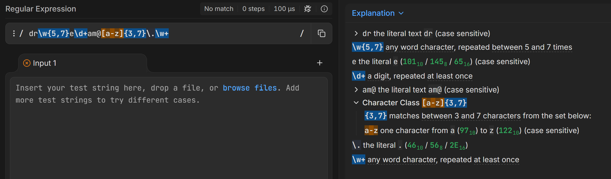
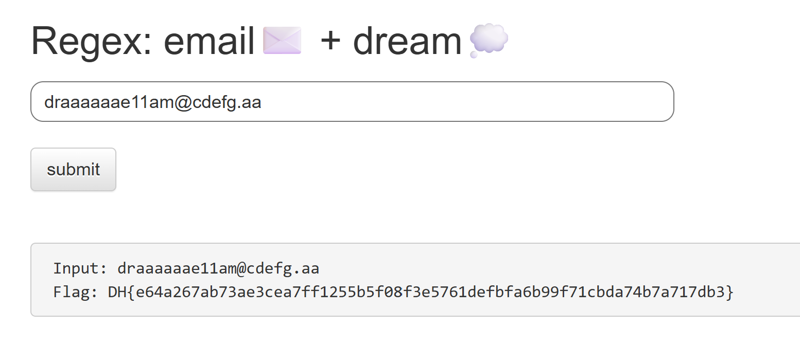

# Đề bài
Obtain a flag by entering a string in the format required by the question. Flags are in flag.txt files and `FLAG` variables.

The flag format is DH {...} This is it.
https://dreamhack.io/wargame/challenges/834
# Solution 
Trước hết quan sát source code để xem ta cần nhập chuỗi string gì để lấy về được flag
```python
input_val = ""
if request.method == "POST":
    input_val = request.form.get("input_val", "")
    m = re.match(r'dr\w{5,7}e\d+am@[a-z]{3,7}\.\w+', input_val)
            if m:
                return render_template("index.html", pre_txt=input_val, flag=FLAG)
return render_template("index.html", pre_txt=input_val, flag='?')
```
Vậy trước hết ta tìm hiểu xem hàm [re.match](https://www.geeksforgeeks.org/python/re-match-in-python/) có tác dụng gì

Phương thức `re.match()` trong Python được dùng để kiểm tra xem một regular expression (regex) pattern có khớp với phần đầu của một string hay không.

Ở đây ta có mẫu regex là `dr\w{5,7}e\d+am@[a-z]{3,7}\.\w+` nên cần dùng tool để xem cần phải nhập string gì cho khớp
Search nhanh thì thấy có tool [regex101](https://regex101.com/) giúp phân tích regex

-> Payload: `draaaaaae11am@cdefg.aa`

-> Flag:
`DH{e64a267ab73ae3cea7ff1255b5f08f3e5761defbfa6b99f71cbda74b7a717db3}`
