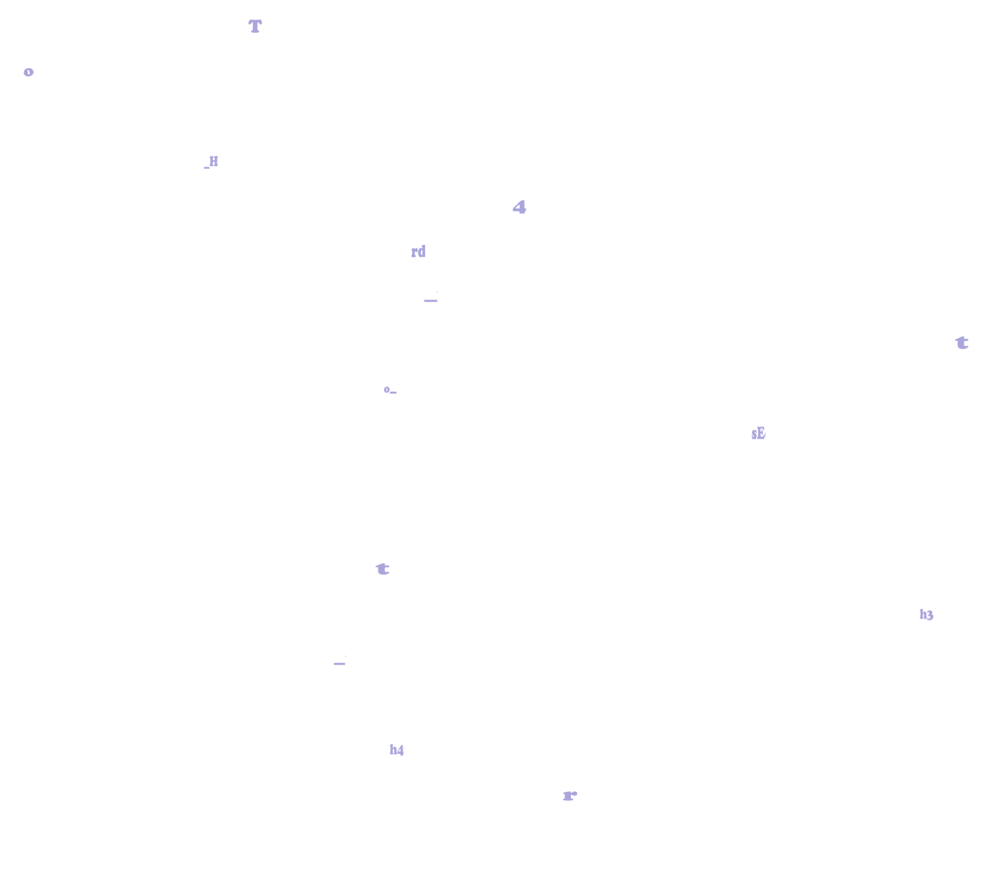
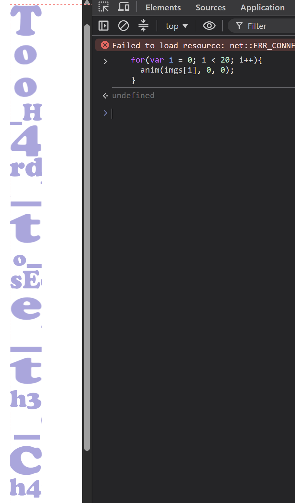
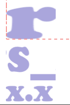

# Đề bài
Stop the flying letters and figure out the entire string! The flag format is `DH{entire_string}`.

❗No attachment is provided for this challenge.  
❗Among the letters included in the flag, `x`, `s`, and `o` are all lowercase.  
❗Among the letters included in the flag, `C` is always uppercase.

https://dreamhack.io/wargame/challenges/850
# Solution 
Vào challenge thấy các chữ cái bay với tốc độ rất nhanh, việc đọc các chữ là không thể nên ta phải tìm cách dừng các chữ cái lại

```javascript
const img_files = ["/static/images/10.png", "/static/images/17.png", "/static/images/13.png", "/static/images/7.png","/static/images/16.png", "/static/images/8.png", "/static/images/14.png", "/static/images/2.png", "/static/images/9.png", "/static/images/5.png", "/static/images/11.png", "/static/images/6.png", "/static/images/12.png", "/static/images/3.png", "/static/images/0.png", "/static/images/19.png", "/static/images/4.png", "/static/images/15.png", "/static/images/18.png", "/static/images/1.png"];
var imgs = [];
for (var i = 0; i < img_files.length; i++){
  imgs[i] = document.createElement('img');
  imgs[i].src = img_files[i]; 
  ...
}
...
function anim(elem, pos, dis){
  function move() {
    pos += dis;
    if (pos > max_pos) {
      pos = 0;
    }
    elem.style.transform = `translateX(${pos}px)`;
    requestAnimationFrame(move);
  }
  move();
}

for(var i = 0; i < 20; i++){
  anim(imgs[i], 0, Math.random()*60+20);
}
```
Từ đoạn script trên ta thấy các ảnh được in ra với thứ tự, chỉ cần ghép lại theo đúng thứ tự sẽ thu về được flag

Ta chỉ cần dùng hàm `anim`, chỉnh `pos` và `dis` về 0 hết để dừng lại
```javascript
for(var i = 0; i < 20; i++){
  anim(imgs[i], 0, 0);
}
```


-> Flag:
`DH{Too_H4rd_to_sEe_th3_Ch4rs_x.x}`
