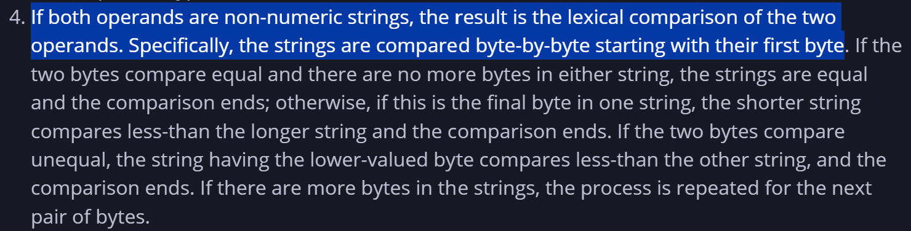
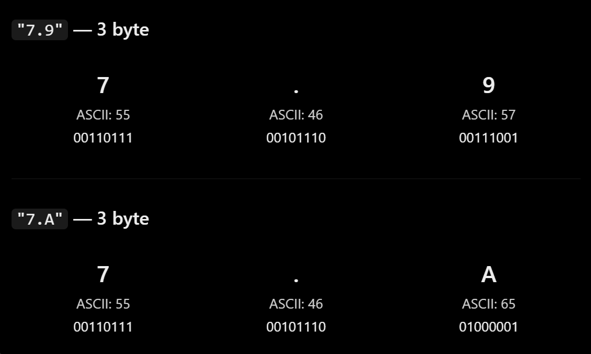
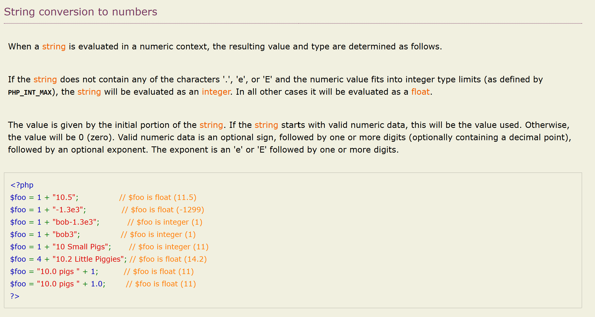
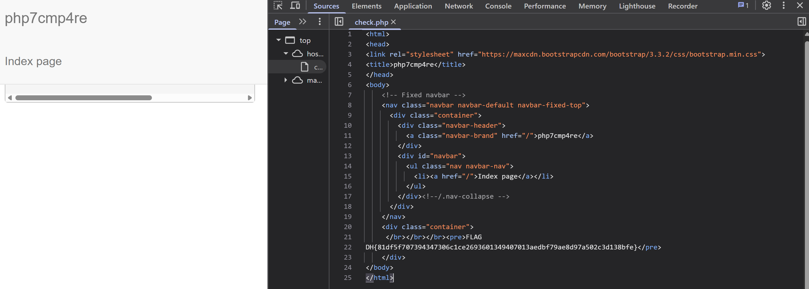

---
{
  title: php7cmp4re,
  date: 2026-11-18,
  ctf: Dreamhack,
  category: web,
  difficulty: Bronze 4,
  tags: [ Type Juggling, PHP, Loose Comparison, Source Code Review ]
}
---

# Đề bài 
This page is written in php 7.4.

Enter an appropriate Input value and obtain a flag.

The flag format is `DH{}`.

https://dreamhack.io/wargame/challenges/1113
# Solution
Đọc source code của file `check.php`
```php
...
if($input_1 != "" && $input_2 != ""){
        if(strlen($input_1) < 4){
          if($input_1 < "8" && $input_1 < "7.A" && $input_1 > "7.9"){
            if(strlen($input_2) < 3 && strlen($input_2) > 1){
              if($input_2 < 74 && $input_2 > "74"){
                echo "</br></br></br><pre>FLAG\n";
                echo $flag;
                echo "</pre>";
                ...
```
Ta cần nhập `input_1` và `input_2` sao cho thỏa mãn các điều kiện


Cách mà php so sánh các chuỗi được mô tả qua tài liệu sau: https://phplang.org/spec/10-expressions.html#relational-operators

Nếu cả hai toán hạng đều là ==chuỗi== không phải dạng số (non-numeric strings), kết quả sẽ được xác định bằng cách so sánh theo thứ tự từ điển (lexical comparison). Cụ thể, hai ==chuỗi== được so sánh từng byte một.

Ở bài này ta dùng mã ASCII để dễ so sánh 
## Input_1
Điều kiện:
- `len(input_1)` < 4
- `'7.9'` < input_1 < `'7.A'` < `'8'`

Vì so sánh diễn ra theo từng kí tự nên ta chỉ cần so sánh với `'7.9'` và `'7.A'` 
-> `input_1` = `'7.<x>'` sao cho 57 < `<x>` < 65

-> `input_1` = `'7.:'` với `:` có mã ASCII: 58 (Thỏa 58 > 57 và 58 < 65)

## Input_2 
Điều kiện:
- ` 1 < len(input_2) < 3 ` <=> `len(input_2) = 2`
- `input_2 < 74` và `input_2 > "74"`

:::warning
`74` và `'74'` là 2 kiểu dữ liệu khác nhau 
```
74    // integer (số nguyên)
"74"  // string (chuỗi số - numeric string)
```
:::

Điểm khai thác của bài này là `74` và `"74"` có kiểu dữ liệu khác nhau, khiến PHP 7.4 lựa chọn hai cơ chế so sánh khác nhau.

:::info
Khi so sánh ==string== với ==integer== thì PHP 7.4 sẽ chuyển `string` về dạng số trước. Để hiểu thêm thì đọc tài liệu ở đoạn [String conversion to numbers](https://durak.org/sean/pubs/software/php-7.4.3/language.types.string.html)

Tóm lại thì khi chuyển một chuỗi thành số, nếu chuỗi bắt đầu bằng dữ liệu số hợp lệ, phần số đó sẽ được sử dụng, ngược lại, giá trị sẽ là 0. PHP sẽ đọc từ trái sang phải và lấy phần đầu tiên có định dạng số hợp lệ. 

Ví dụ:
| Chuỗi ban đầu | Giá trị số | Giải thích |
|---|---|---|
| `"7a"` | `7` | Lấy `7`, dừng tại `a` |
| `"74abc"` | `74` | Lấy `74`, dừng tại `a` |
| `"7.9abc"` | `7.9` | Lấy `7.9`, dừng tại `a` |
| `"1e2abc"` | `100` | `1e2` = 1 × 10² |
| `"abc74"` | `0` | Không bắt đầu bằng số |
| `"7abc8"` | `7` | Lấy `7`, dừng tại `a`, bỏ qua `bc8` |
:::

->  `input_1` = `'7A'` {Thỏa 7 < 74 và `'A'` > `'4'` (có mã ASCII: 65 > 52)}

## Flag
Sau khi nhập 2 input

-> Flag:
`DH{81df5f707394347306c1ce2693601349407013aedbf79ae8d97a502c3d138bfe}`
